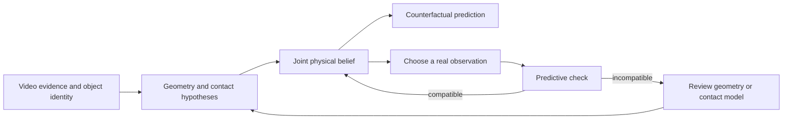

# 네 연구자의 논문을 바탕으로 다시 설계한 Contact-Model Ambiguity 연구

검토일: 2026-11-05. 대상: Yale Song, Seon Joo Kim, Seungryong Kim, Lingjie Liu.

이 보고서는 이전 `research_review_v4.md`의 2017–2026년 대표 논문 목록과 `physics_scene_belief_correlated_v3_literature_review.md`의 다음 연구 방향을 이어받는다. 이번에는 현재 가설에 직접 영향을 주는 논문의 Introduction, Related Work, Method를 다시 읽고, 그 안의 핵심 reference를 2–3단계 따라갔다. **네 분의 모든 논문과 모든 reference를 빠짐없이 전문 독해했다는 뜻은 아니다.** 전체 경향을 위한 대표작 검토와 특정 claim을 위한 원문 검토를 구분했다. 새 실험의 수치·실행 evidence·한계는 별도 experiment report에 둔다.

아래의 ‘예상 feedback’은 실제 발언이나 개인 성향에 대한 정보가 아니다. **공개 논문에서 확인한 연구 문제와 평가 방식을 바탕으로 내가 만든 가상의 연구 질문**이다. 연구자에게 연락하거나 실제 지도를 받은 사실은 없다.

## 1. 지금의 중심 질문

현재 가장 타당한 질문은 다음과 같다.

> Factual observation에 잘 맞는 physical model이 새로운 intervention에서는 틀릴 때, 그 원인이 부족한 observation인지, posterior approximation인지, 잘못된 contact model인지 구분할 수 있는가? 추가 measurement가 어느 오류를 줄이는지도 검증할 수 있는가?

이 질문은 ‘더 많은 particles를 유지하자’보다 범위가 분명하다. 이전 실험에서는 작은 grid와 prior importance particles가 실패했지만, standard SMC와 conditional quadrature가 gap을 거의 없앴다. 따라서 **현재까지의 증거로 새로운 posterior algorithm의 필요성을 주장할 수 없다.** 이번 단계의 세 후보는 다음처럼 다르게 취급한다.

| 후보 | 이번에 검증할 주장 | 잘되어도 바로 주장할 수 없는 것 |
|---|---|---|
| A. Benchmark / failure taxonomy | 서로 다른 contact sequence와 model mismatch에서 오류의 원인을 분리할 수 있다. | 세 가지 synthetic scene만으로 현실의 physical reasoning을 대표한다. |
| B. Contact-branch-preserving compression | 같은 posterior와 같은 retained support budget에서 branch stratification이 decision/prediction을 더 잘 보존한다. | upstream SMC 비용을 제외하고 end-to-end 효율이 좋아졌다고 주장한다. |
| C. Model checking / expansion | 추가 probe가 기존 model class의 부적합을 드러내며, model class 확장이 prediction을 개선한다. | generic Bayesian model checking이나 mixture posterior 자체가 새 원리다. |

## 2. Yale Song: 의미 있는 task와 intervention을 먼저 정의하는 관점

### 연구 흐름

2017–2019년의 TGIF-QA, video prediction, Polysemous Visual-Semantic Embedding은 시간에 걸친 움직임과 visual–language 의미를 어떻게 표현할 것인지에 연결된다. 2020–2022년에는 ACAV100M과 noisy contrastive learning 같은 data/representation 연구와 함께, CausalCity의 controlled causal scenarios, Neural-Sim의 task-dependent synthetic data generation이 나타난다. 2023–2025년에는 Ego-Exo4D, procedure/goal understanding, temporal evidence와 history 활용으로 이어진다. 이 연도별 정리는 기존 v4의 대표작 기록을 승계한다. [TGIF-QA](https://arxiv.org/abs/1704.04497) · [Polysemous Visual-Semantic Embedding](https://arxiv.org/abs/1906.04402) · [ACAV100M](https://arxiv.org/abs/2101.10803) · [Ego-Exo4D](https://arxiv.org/abs/2311.18259)

현재 공식 소개는 long-form video generation, robotic manipulation, AI agents를 관심사로 명시한다. 이력 전체를 robotics 하나로 환원하기보다, **관측된 영상의 의미를 추론하고, 목적에 맞는 관측·데이터·행동을 만드는 문제로 넓어져 왔다**고 해석하는 편이 적절하다. [공식 소개](https://yalesong.github.io/)

### 이번에 재독한 논문에서 얻은 기준

**CausalCity**의 중요한 부분은 simulation의 시각적 복잡도만이 아니다. High-level scenario와 agency, confounder를 통제하며 causal discovery를 평가한다. 원문은 static video collection으로는 원하는 counterfactual이 존재하지 않을 수 있음을 지적한다. 또한 perception을 우회하거나 simulator mask를 제공한 baseline setting을 명시한다. 우리의 실험도 어느 단계에 privileged information이 들어갔는지 숨기면 안 된다. [CausalCity, §1–3·5–6](https://arxiv.org/html/2106.13364)

**Neural-Sim**은 NeRF rendering distribution을 downstream validation loss에 맞춰 조정한다. 여기서 얻는 교훈은 ‘많은 데이터를 만들었다’와 ‘목표 task에 필요한 데이터를 만들었다’를 구분하라는 것이다. 다만 synthetic training image를 고르는 문제와 실제 물체에 대한 새 measurement를 얻는 문제는 다르다. Virtual rendering을 독립적인 physical evidence로 세면 안 된다. [Neural-Sim, §2–3](https://arxiv.org/html/2207.11368)

### 예상 feedback와 내가 반영한 수정

**가상 질문:** “Counterfactual이라고 부르는 대상이 무엇인가? 같은 물체의 물성과 환경을 유지하고 initial condition만 바꾸는가? 아니면 영상에서 그럴듯한 미래를 생성하는가?”

**내 대응:** hidden geometry, restitution, friction은 고정하고 source의 lateral offset만 바꾸는 query를 명시했다. Factual과 target이 같은 latent world를 공유한다. Probe는 별도 reset에서 실제로 관측한 measurement로 정의하고, target intervention 자체를 몰래 실행해 그 정답을 policy에 전달하지 않는다.

**가상 질문:** “Query-specific policy가 정말 필요한가? 특정 scene에서는 언제나 한 가지 probe만 하면 되는 것 아닌가?”

**내 대응:** scene family별로 validation에서 정한 query-type rule뿐 아니라, query의 실제 offset 값까지 사용하는 rule을 비교한다. 모든 policy에 한 번의 추가 observation을 허용하고 stop을 main comparison에서 제외한다. 따라서 gain이 있다면 관측 여부가 아니라 **유용한 observation 사이의 선택**에서 나와야 한다.

**가상 질문:** “이 작은 physics 실험은 video understanding 연구와 어디서 만나는가?”

**내 대응:** 아직 자연어·사건 해석을 해결한 결과는 아니다. 최종 task에서는 ‘직전에 밀었던 물체’라는 instruction을 object track과 연결하고, 그 물체에 대한 intervention의 결과를 예측해야 한다. 현재 단계는 그중 physical inference의 주장이 성립하는지 확인하는 diagnostic이다. 이 구분을 없애기 위해 VLM을 형식적으로 붙이지 않겠다.

## 3. Seon Joo Kim: 대상과 관측 근거를 끝까지 유지하는 관점

### 연구 흐름

이 보고서의 Seonjoo Kim은 Yonsei CIPLab의 **Seon Joo Kim, 김선주**다. 2017–2019년에는 computational photography, light-field depth의 EPINET, editing의 TAGAN, video object segmentation의 STM이 함께 나타난다. 2020–2022년에는 video restoration과 VISOLO/VITA 같은 instance segmentation을 발전시켰다. 2023–2024년의 MiniROAD/ActionSwitch는 online temporal decision을, 2025년 Omni-RGPT는 region-specific understanding을 다룬다. 최근 RelationVGGT와 HuRo는 각각 multi-view relation과 human-to-robot observation/action alignment로 이어진다. [EPINET](https://arxiv.org/abs/1804.02379) · [TAGAN](https://arxiv.org/abs/1810.11919) · [VITA](https://arxiv.org/abs/2206.04403) · [MiniROAD](https://openaccess.thecvf.com/content/ICCV2023/html/An_MiniROAD_Minimal_RNN_Framework_for_Online_Action_Detection_ICCV_2023_paper.html)

내가 읽는 공통 관심은 **어느 대상의 어떤 정보인지, 시간과 관측 조건이 달라져도 유지하는 것**이다. 영상에서 한 물체를 놓친 오류와, 그 물체의 dynamics를 잘못 추정한 오류를 합쳐 하나의 physics error로 부르면 이 연결이 사라진다.

### 이번에 재독한 논문에서 얻은 기준

**STM**은 past frames와 masks를 external memory에 두고 query pixel이 space-time 위치 전반의 정보를 읽게 한다. Memory에 이미 추정한 mask도 들어간다는 점은 우리의 belief update에 중요한 경고다. 자기 prediction을 다시 쓴다고 새 ground truth가 생기는 것은 아니며, 잘못된 identity가 누적될 수 있다. [STM, §2–3](https://arxiv.org/html/1904.00607)

**Omni-RGPT**의 Token Mark는 region과 text가 같은 대상을 지칭하게 하고, Temporal Region Guide Head는 full tracklet을 주지 않은 video에서도 region reference를 유지하도록 학습한다. 이는 physical parameter 추정 방법은 아니지만, 어떤 object의 measurement를 posterior에 넣는지 명확히 해야 한다는 설계 기준을 준다. [Omni-RGPT, §2–3](https://arxiv.org/html/2501.08326)

**RelationVGGT**는 subject mask와 relational query에서 multi-view target masks를 예측한다. ‘resting on’이라는 relation을 segment하는 것과 실제 normal force·friction·contact stability를 식별하는 것은 별개의 과제다. Project page의 geometry backbone은 이름만 보고 VGGT라고 추정하면 안 된다. 설명에는 Pi3 encoder tokens와 DINOv2 features의 결합이 제시된다. [저자 project의 Method](https://relationvggt.github.io/)

**HuRo**에서는 visual conversion과 retargeted action supervision을 함께 평가한다. 관측만 robot처럼 바꾼 경우와 action까지 맞춘 경우를 분리한 ablation이 유용하다. 우리도 visual consistency가 좋아졌다는 결과를 intervention validity의 증거로 대체하면 안 된다. [HuRo, §2–3](https://arxiv.org/html/2609.10706v5)

### 예상 feedback와 내가 반영한 수정

**가상 질문:** “당신이 RGB라고 부르는 입력에서 실제로 무엇을 추출했나? Simulator state를 pixel로 한 번 바꾸었다가 다시 읽은 것인가?”

**내 대응:** 이번 synthetic observation은 바로 그런 제한된 RGB sensor다. Rasterization, blur, localization jitter를 거친 color centroid와 bounding box를 사용한다. GT coordinate를 policy에 직접 주지는 않지만, known color, camera calibration, scene family를 가정한다. **General visual reconstruction gate를 통과했다고 표현하지 않는다.** 이 sensor에서 얻은 이득과 실제 scene perception의 성능은 별도로 검증해야 한다.

**가상 질문:** “새 view가 좋은 이유가 geometry ambiguity를 줄여서인가, detector noise가 우연히 작아서인가?”

**내 대응:** observation별 noise scale을 공개하고, model-correct null worlds에서 predictive-check threshold를 별도로 calibrate한다. 후속 실제 영상에서는 같은 method로 모든 view를 처리하고, visibility·occlusion·track identity별로 stratified evaluation을 하겠다. Synthetic noise calibration만으로 real camera error를 대신하지 않는다.

**가상 질문:** “한 mask 안에 들어 있는 pixel 평균이 실제 같은 물체 점인가?”

**내 대응:** Deform360의 서로 다른 view에서 silhouette centroid를 같은 material point라고 간주해 triangulation하지 않았다. 변형과 occlusion 때문에 centroid가 서로 다른 표면 부분을 대표할 수 있다. 실제 3D contact inference에는 material-point correspondence 또는 uncertainty가 있는 surface reconstruction이 필요하다.

## 4. Seungryong Kim: correspondence와 중간 표현이 실제로 무엇을 보존하는가

### 연구 흐름

2017–2019년의 FCSS/RTNs 계열은 semantic correspondence와 matching을 다룬다. 2020–2022년 CATs, SemiMatch, NeMF는 cost aggregation, supervision 효율, continuous representation을 발전시켰다. 여기서 NeMF는 **Neural Matching Fields**다. 이후 GeCoNeRF, DiffMatch, DreamMatcher 등에서 correspondence가 reconstruction과 generation의 도구로 확장된다. 이 시기별 정리는 기존 v4의 논문별 기록을 승계한다. [FCSS](https://seungryong.github.io/FCSS/) · [RTNs](https://seungryong.github.io/RTNs/) · [SemiMatch](https://arxiv.org/abs/2203.16038) · [NeMF](https://cvlab-kaist.github.io/NeMF/) · [DiffMatch](https://cvlab-kaist.github.io/DiffMatch/) · [DreamMatcher](https://cvlab-kaist.github.io/DreamMatcher/)

이번 재검토에서는 2026-11-02 공개된 **Trace4D**, 2026-11-03 공개된 **DreamX**가 특히 중요했다. 둘 다 현재 시점에서 공개 원고로 읽었으며, 확인하지 않은 main-conference acceptance를 붙이지 않았다. 전자는 4D state sequence를 reasoning evidence로, 후자는 video representation을 compact latent action으로 옮긴다. [Trace4D](https://arxiv.org/abs/2611.02759) · [DreamX](https://arxiv.org/abs/2611.05377)

### 이번에 재독한 논문에서 얻은 기준

**CATs**는 feature similarity가 높은 match가 곧 올바른 correspondence가 아니라는 문제에서 출발해, correlation 전체의 global consensus를 활용한다. Semantic correspondence는 같은 종류의 다른 object 사이에서도 정의될 수 있으므로, 이를 곧바로 같은 physical instance의 identity로 해석하면 안 된다. [CATs, §2–3](https://arxiv.org/html/2106.02520)

**Trace4D**는 Pi3 point maps와 tracked masks 등으로 reference 4D states를 만들고, state changes와 temporal visual evidence를 연결해 reasoning을 학습한다. Reference state는 reconstruction-derived annotation이며 perfect metric ground truth와 다르다. 또한 explicit 4D state sequence가 있다는 사실만으로 intervention에 대한 causal dynamics가 식별되지는 않는다. [Trace4D, §2–3](https://arxiv.org/html/2611.02759)

**DreamX**는 pretrained video diffusion backbone에서 compact latent actions를 읽고, initial frame과 latent actions로 future video를 복원하도록 학습한다. 중요한 문제의식은 reconstruction이 잘된다는 이유만으로 action representation이 appearance나 embodiment와 분리되었다고 보장할 수 없다는 점이다. 우리의 posterior compression도 density나 reconstruction error만 낮출 것이 아니라 실제 observation response와 query outcome을 보존해야 한다. [DreamX, §2–3](https://arxiv.org/html/2611.05377)

### 예상 feedback와 내가 반영한 수정

**가상 질문:** “Contact branch를 보존한다고 했는데, 무엇이 branch이고 왜 그 partition이어야 하는가?”

**내 대응:** 이번 branch는 공개된 query pool에서 발생하는 obstacle-contact sequence vector다. 같은 sequence라도 outgoing velocity와 observation likelihood가 다를 수 있으므로, 이것이 충분통계라는 주장은 하지 않는다. 단순 stratification이 실제 predictive score를 개선하는지 먼저 비교한다. 개선되지 않으면 더 복잡한 network를 붙여 성과를 강제하지 않는다.

**가상 질문:** “Compression이 좋아 보이는 이유가 upstream에서 훨씬 비싼 posterior를 이미 계산했기 때문 아닌가?”

**내 대응:** 같은 SMC posterior를 입력으로 받아 64/128 support로 줄이는 비교와 full inference를 구별한다. Shared upstream cost를 명시하고, 이 실험만으로 end-to-end efficient inference claim을 하지 않는다. Full SMC refit을 추가해 compression loss와 post-observation importance collapse도 분리한다.

**가상 질문:** “한 장면의 contact sequence ID에 맞춘 방식이 unseen topology에도 적용되는가?”

**내 대응:** 현재 세 scene family의 held-out worlds는 새로운 parameter 조합이며, 완전히 unseen topology transfer는 아니다. 이를 확인하기 전에는 general contact reasoning method라는 제목을 쓰지 않겠다. 후속 표현은 integer branch ID 대신 contact graph, signed distance, normal direction, visibility evidence처럼 재사용 가능한 정보를 가져야 한다.

## 5. Lingjie Liu: 보이는 구조와 실행 가능한 물리의 차이를 검증하는 관점

### 연구 흐름

2017–2018년 Wire Art Reconstruction과 CurveFusion은 복잡하고 가는 구조의 geometry/topology를 다뤘다. 2019–2022년에는 neural rendering, NSVF, NeuS, NeuralActor, visibility와 human deformation으로 확장된다. Physics Informed Neural Fields for Smoke가 보여주듯 physics는 최근에 갑자기 추가된 관심사가 아니다. 2023–2024년에는 reconstruction 효율, editing, human motion, embodied scene generation이 병행된다. [CurveFusion](https://lingjie0206.github.io/papers/curvefusion/) · [NeuS](https://lingjie0206.github.io/papers/NeuS/index.htm) · [NeuralActor](https://vcai.mpi-inf.mpg.de/projects/NeuralActor/) · [Smoke Reconstruction](https://arxiv.org/abs/2206.06577)

2025–2026년 Vid2Sim, Pixie, UniPixie는 physical parameters와 executable simulation을 직접 다룬다. 공식 소개의 세 축도 3D/4D World Modeling, Physics-Grounded World Dynamics, Embodied AI/Humanoid Robotics다. 내가 보는 연속성은 **관측되지 않은 조건에서도 사용할 수 있는 구조적 representation을 만드는 것**이다. [공식 소개](https://lingjie0206.github.io/)

### 이번에 재독한 논문에서 얻은 기준

**Vid2Sim**은 feed-forward initialization과 scene-specific refinement를 결합하고, mesh-free reduced simulation을 사용한다. Appearance, geometry, material을 함께 맞춘다는 점에서 우리의 geometry–restitution coupling과 문제의식이 연결된다. 그러나 이것이 모든 parameter의 unique identification이나 calibrated posterior를 보장한다는 뜻은 아니다. [Vid2Sim, §2–4](https://arxiv.org/html/2506.06440)

**UniPixie**는 plausible material range의 soft-to-stiff axis를 control parameter로 다루며 여러 solver용 parameter를 생성한다. 원문의 range annotation과 interpolation supervision을 보면, 이것을 특정 실제 물체의 repeated intervention에 의해 보정된 posterior라고 읽을 수는 없다. 그렇다고 ‘기존 physics-from-vision은 모두 deterministic’이라고 비판할 수도 없다. 이미 ambiguity를 직접 다루는 선행연구다. [UniPixie, §2–3·Appendix 6](https://arxiv.org/html/2606.05399v2)

### 예상 feedback와 내가 반영한 수정

**가상 질문:** “Geometry와 material이 서로 보상하는 것과 collision solver가 다른 것은 어떻게 분리했나?”

**내 대응:** latent geometry/material inference와 sharp/rounded proxy class를 분리했다. 외곽 크기가 같은 rounded rectangle에서도 contact normal과 sequence가 달라진다. 별도 PyBullet audit에서는 timestep, collision margin, contact ERP/slop 설정을 명시한다. Solver의 numerical setting이 다르면 그 차이를 model novelty로 해석하지 않는다.

**가상 질문:** “정답 model을 mixture에 넣고 posterior를 돌린 것 이상의 contribution이 있는가?”

**내 대응:** always-broad mixture를 strong baseline으로 둔다. Correct proxy를 알려주는 privileged baseline과, broad class에도 truth가 없는 outside setting을 별도로 평가한다. Adaptive expansion이 always-broad보다 못하면 효율적인 adaptation method라는 주장을 버린다.

**가상 질문:** “Real object의 unseen interaction을 맞혀 봤나?”

**내 대응:** 현재 실제 장비는 없다. 공개 Deform360의 동일 물체·서로 다른 interaction 영상은 확보했지만, 그것만으로 fitted physical twin의 held-out intervention accuracy를 측정한 것은 아니다. Material point tracking, grasp boundary condition, initial shape registration을 확보한 뒤에야 물성 불확실성과 contact/support ambiguity를 공정하게 비교할 수 있다.

## 6. Background와 Related Work를 따라가며 바뀐 가설

Reference를 계속 읽는 목적은 citation 수를 늘리는 것이 아니라, ‘새롭다고 생각했던 주장’을 더 정확한 질문으로 바꾸는 데 있다. 이번에 실제로 따라간 주요 경로는 다음과 같다. 화살표는 앞 원문에서 뒤 연구가 reference로 등장한 경로이며, 후속 검토 범위는 각 항목에 표시한다.

| Recursive reading 경로 | 처음의 생각 | 읽은 뒤의 수정 |
|---|---|---|
| CausalCity → CLEVRER → CoPhy | Video에서 intervention 결과를 예측하면 새롭다. | Physical counterfactual benchmark와 factual experience를 통한 hidden physics 추정은 이미 있다. 차별화 후보는 calibration, acquisition interface, model mismatch의 분리다. |
| Omni-RGPT → MotionEpic/Video-of-Thought → Action Genome | Object/event representation을 붙이면 차별화된다. | Object–relation–time decomposition과 grounded reasoning도 이미 있다. Semantic relation과 physical constraint가 언제 불일치하는지를 측정해야 한다. |
| Trace4D → Pi3 → VGGT | 4D state를 쓰면 geometry uncertainty가 해결된다. | Feed-forward geometry와 confidence map은 유용하지만, confidence를 calibrated joint physical posterior로 볼 수 없다. Reference-frame/scale 문제도 남는다. |
| UniPixie → Vid2Sim → Simplicits | 여러 physics hypotheses를 simulation-ready하게 만들면 새롭다. | Plausible material distributions와 geometry-agnostic simulation은 이미 발전했다. 실제 evidence-conditioned reliability를 별도로 입증해야 한다. |
| UniPixie → PhysDreamer → physics-integrated representations | 생성한 motion도 물성 식별의 추가 evidence다. | Generated video prior와 실제 measurement는 다르다. Plausibility를 실제 물체의 truth와 혼동하지 않는다. |

각 경로의 원문: [CLEVRER](https://arxiv.org/html/1910.01442), [CoPhy](https://arxiv.org/html/1909.12000), [Video-of-Thought](https://arxiv.org/html/2501.03230), [Action Genome](https://arxiv.org/html/1912.06992), [Pi3](https://arxiv.org/html/2507.13347), [VGGT](https://arxiv.org/html/2503.11651), [Simplicits](https://arxiv.org/html/2407.09497), [PhysDreamer](https://arxiv.org/html/2404.13026).

CoPhy의 paired factual/counterfactual에서는 confounders를 공유한다. 같은 물체를 다른 날 찍은 영상이라는 사실만으로 같은 조건의 paired counterfactual이라고 부를 수 없는 이유다. Action Genome의 spatial/contact relation label도 force나 material parameter의 정답을 제공하는 것은 아니다. Pi3/VGGT의 point map은 geometric intermediate representation이며, observation likelihood와 calibration protocol은 별도로 필요하다. Simplicits의 reduced basis는 simulation 표현의 효율을 높이지만 어떤 real object의 material이 식별되는지는 다른 문제다.

이 경로는 여기서 일단 멈춘다. 추가 reference가 새로운 measurement, baseline 또는 falsification criterion을 더하지 않는다면 이번 실험 설계를 바꾸지 않기 때문이다. 새로운 empirical failure가 나오면 그 원인에 해당하는 문헌 가지를 다시 확장하는 방식이 효율적이다.

## 7. 가장 가까운 선행연구가 금지하는 과장

| 선행연구 | 이미 존재하는 아이디어 | 우리의 남은 검증 |
|---|---|---|
| [Task-Specific NBV with Uncertain Geometry](https://arxiv.org/html/2605.05095) | Geometry posterior와 downstream utility를 이용한 view selection, physics task 포함 | Discrete contact/model ambiguity와 continuous parameter coupling에서 어떤 추가 문제가 남는가? |
| [IDTD](https://arxiv.org/html/2610.10905) | Parameter compensation과 identifiability를 고려한 trajectory design | Local FIM이 아닌 여러 branch가 필요하다는 것을 strong posterior baseline 대비 보여 주는가? |
| [Action-BED](https://arxiv.org/html/2606.23662) | Expected future loss를 직접 줄이는 task-driven design | EVSI 자체를 새 method라고 부를 수 없다. Practical interface와 reliability evidence가 필요하다. |
| [Inside-Out SMC²](https://arxiv.org/html/2402.07868) | Sequential design에서 particle inference와 policy optimization | Naive importance collapse를 particle methods 전체의 실패로 일반화할 수 없다. |
| [VideoPhysEdit](https://arxiv.org/html/2609.35134v1) | Executable rigid scene, physical intervention, multiple candidate handling | Candidate가 존재한다는 사실과 calibrated posterior의 차이를 실제로 측정해야 한다. |
| [PhysTwin](https://arxiv.org/html/2503.17973) | Sparse real RGBD에서 reconstruction, physical fitting, unseen interaction | Synthetic rigid contact diagnostic이 이 pipeline의 성능을 대체하거나 반박하지 못한다. |
| [Kennedy–O’Hagan calibration](https://rss.onlinelibrary.wiley.com/doi/abs/10.1111/1467-9868.00294) | Parameter uncertainty와 model discrepancy의 분리 | Generic discrepancy correction은 새롭지 않다. Contact-specific measurable mechanism이 필요하다. |

앞의 네 논문은 이번에 관련 원문 부분을 다시 확인했고, VideoPhysEdit/PhysTwin은 이전 deep dive의 원문 검토를 승계했다. Kennedy–O’Hagan은 이번에 publisher abstract와 bibliographic information을 확인했으며 전문을 읽은 것으로 표시하지 않는다. 서로 다른 task의 발표 수치를 가져와 우리 toy 결과와 순위를 매기지 않았다.

## 8. 네 분의 관점이 만나는 최종 연구 형태

내가 네 분에게 공동 지도를 받는 상황이라면, 하나의 거대한 model보다 다음의 연결을 입증하겠다.

이때 평가해야 할 출력은 멋진 generated video 하나가 아니다. Object binding의 정확도, geometric/contact hypothesis의 coverage, counterfactual predictive score, 실제 observation의 비용, misspecification detection의 false positive와 false negative가 필요하다. Video rendering은 이 중간 결과를 전달하는 방식이 될 수 있다.

최종 논문 기여 후보는 **“visual reconstruction에서 생긴 contact uncertainty가 physical counterfactual reliability를 어떻게 망가뜨리는지 분리하고, 어떤 measurement가 그 오류를 줄이는지 검증하는 protocol과 correction mechanism”**이다. 이 문장은 아직 성취한 결과가 아니라 연구 목표다. 실제 실험에서 simple broad-model SMC가 충분하다면, 별도 inference method를 만들지 않는 것이 맞다.

## 9. 실제 구현으로 옮긴 가설과 중단 기준

| 가설 | 실행한/실행하도록 구성한 검증 | 기각·축소할 조건 |
|---|---|---|
| H1. Query 내용이 useful observation을 바꾼다. | 세 family, 같은 source-shift query type, view와 세 dynamic probe, EIG·fixed rules·EVSI 비교 | Gain이 stop 여부나 numerical tie에만 의존하거나 query-value rule과 구분되지 않음 |
| H2. Contact branch compression이 효율적이다. | 같은 upstream posterior의 systematic vs branch-stratified 64/128 support, 3 seeds | Standard sampling과 반복 가능한 차이가 없거나 preprocessing 비용이 이득을 없앰 |
| H3. Wrong contact model은 좁고 틀린 prediction을 만든다. | Sharp truth, rounded truth, outside-model truth; sharp/broad/known-proxy comparisons | Model mismatch 효과보다 SMC convergence나 sensor error가 지배함 |
| H4. Predictive check가 유용한 expansion을 결정한다. | 별도 null calibration, held-out center probe, same-data refit, always-broad 및 noise-inflation baseline | Misspecification을 놓치거나 always-broad보다 비용·정확도 면에서 불리함 |
| H5. 공개 실제 영상으로 physical validation에 진입할 수 있다. | Deform360 동일 물체 3 interactions × 2 views의 download·integrity·alignment audit | 초기 state/action/contact boundary를 충분히 복원하지 못해 counterfactual 정답을 정의할 수 없음 |

새 실험은 위 가설을 지지하도록 결과를 고르는 과정이 아니다. 특히 H2/H4는 실패할 가능성이 충분하다. 실패하면 A의 diagnostic evidence를 보존하고, 실제 영상에서 확인할 수 있는 더 좁은 문제를 택한다. Main-conference paper로 발전시킬지 여부는 full visual pipeline과 independent physical intervention에서의 추가 검증이 결정해야 한다.

## 10. 실험을 완료한 뒤의 가상 지도 회의와 최종 선택

아래는 계획이 아니라 이번 서버 실행 결과를 반영한 판단이다. 72 main worlds, 독립 calibration 192 worlds, three layouts, full SMC-1536 refit, continuous-rounding baseline, PyBullet audit를 완료했다. 수치의 단위·예산·CI·원본 경로는 [실험 보고서](/Users/mindongjun/Documents/Codex/2026-10-30/new-chat/outputs/physics_scene_belief_contact_model_v4_experiment_report.md)에 있다. [원문 확인 기록](/Users/mindongjun/Documents/Codex/2026-10-30/new-chat/outputs/physics_scene_belief_contact_model_v4_reading_ledger.md)도 별도로 남겼다.

| 공개 논문에서 도출한 가상 질문 | 실제 결과와 내 답변 | 연구 결정 |
|---|---|---|
| Yale Song의 task/intervention 관점: “강한 posterior update를 써도 query-specific observation이 필요한가?” | EVSI MSE 0.012678, query-value rule 0.017502. Relative reduction 27.6%, paired 95% CI는 MSE difference [−0.008309, −0.001573]. | Defined sensor/action pool에서의 acquisition 효과는 유지한다. EVSI 자체를 새 알고리즘이라고 부르지 않는다. |
| Seon Joo Kim의 observation/identity 관점: “실제 영상에 남아 있는 evidence를 method가 제대로 이용했는가?” | Known camera/color를 쓰고 view feature에서 corner curvature를 버렸다. Real cloth 영상도 initial state와 frame timing이 달랐다. | General visual uncertainty나 real counterfactual validation을 통과했다고 하지 않는다. Boundary evidence를 보존하는 baseline부터 필요하다. |
| Seungryong Kim의 representation 관점: “Branch를 보존했다고 하지만 정말 보존했는가?” | Joint query-signature가 최대 167개였다. 64/128 support에서 15/14 test worlds는 systematic fallback을 사용했다. 평균 MSE 개선의 CI도 zero를 포함한다. | 현 compression은 보류한다. Contact label만으로 observation response와 continuous outcome을 보존하지 못하는지 다시 정의해야 한다. |
| Lingjie Liu의 simulation 관점: “이것은 새로운 contact law의 문제인가, 거친 geometry parameterization의 문제인가?” | Continuous rounding을 추가한 standard SMC가 discrete broad보다 MSE를 0.014648→0.012462로 낮췄다. Marginal coverage는 88.72%→94.27%였다. | 우선 continuous geometry baseline을 채택한다. Generic model expansion의 novelty를 주장하지 않는다. |

마지막 행에도 중요한 예외가 있다. Continuous rounding은 sharp subgroup에서는 discrete broad보다 MSE가 높았다. Overall gain이 모든 regime의 우월성을 뜻하지 않는다. 또한 두 방식 모두 같은 impact law를 사용하므로 이 결과는 arbitrary simulator mismatch를 해결한 evidence가 아니다.

Predictive-check-triggered expansion도 이번 형태로는 채택하지 않는다. SMC-768에서 adaptive MSE는 0.018987, always-broad는 0.015283이었고 initial fit을 포함한 forward observation evaluations도 adaptive가 약 47% 많았다. Rounded truth 15개 중 10개, discrete support 밖 truth 18개 중 9개를 놓쳤다. 이 결과는 ‘추가 probe가 언제나 model error를 찾아 준다’는 가설을 반박한다.

**내 최종 선택은 A를 중심으로 하고, C를 평가 대상인 failure mechanism으로 남기며, B의 현 구현은 보류하는 것이다.** 다음 주제는 “실제 visual reconstruction에서 생긴 collision-boundary uncertainty를 유지했을 때 counterfactual prediction의 신뢰성이 개선되는가?”로 좁힌다. 관측 영상에서 자연스럽게 나타나는 오류를 수집하고, continuous-proxy SMC로도 설명되지 않는 gap이 있는지 먼저 확인한다. 더 복잡한 toy나 더 큰 neural model을 추가하는 것 자체를 진전으로 세지 않는다.

현재 상태를 평가하면 **좋은 연구 질문과 정직한 diagnostic은 생겼지만, 강한 논문 기여는 아직 확보하지 못했다.** 가장 중요한 다음 성과는 새로운 약어를 붙인 model이 아니라, 동일 object의 held-out physical intervention에서 reproducible improvement를 보여 주는 것이다. 공개 dataset의 download·integrity audit는 완료했지만, 그 physical validation은 아직 수행하지 않았다.
