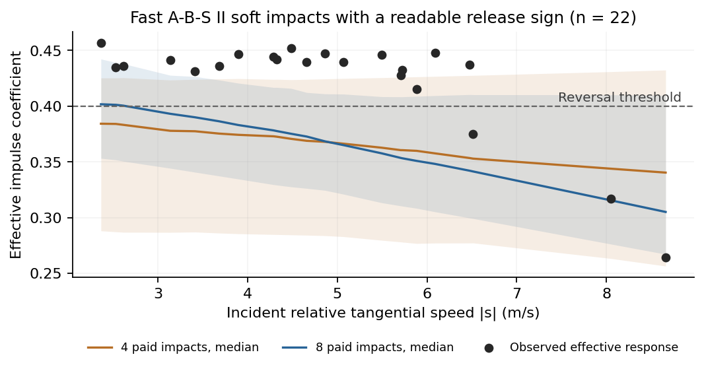

# v74 · 빠른 anti-spin impact에서 이탈 방향이 틀리는 이유와 4회·8회 보정의 효과

**8회 calibration에서는 질문의 두 조건을 모두 충족했다.** A-B-S II soft의 빠른 입사에서 부호를 따로 보정한 elastic impulse의 방향 적중률은 **75.9%**, 같은 판독 대상에서 v73 majority vote는 **58.9%**였다. 보정 후 velocity·spin 오차는 **0.343 m/s·13.18 rad/s**로, 원래 elastic impulse의 **0.378 m/s·17.76 rad/s**보다도 작았다. 별도로 나눈 두 번째 평가에서도 8회 적중률은 **72.3% 대 59.8%**였다. 4회에서도 평균은 개선됐지만 공식 test에서 방향 차이의 불확실성이 컸다. [공식 결과](model/result/official/metrics.csv) · [두 번째 분할](model/result/secondary/metrics.csv) · [판정 기준](analysis/CRITERIA_KO.md)

**새 시편의 부호를 학습해야 한다는 주장은 이 결과로 지지되지 않는다.** 빠른 입사에서는 입사 접촉점 상대속도의 부호를 항상 뒤집는 규칙이 각각 **19/22(86.4%)와 24/33(72.7%)**를 맞혔다. 이 규칙은 이 두 평가에서 source만으로 만든 sign predictor와 모든 빠른 impact에서 같은 방향을 냈다. 단순 반전도 같은 4회·8회 calibration으로 갱신한 elastic의 연속 출력에 적용했다. 아낀 것은 target의 부호를 별도로 학습하는 절차이며, 연속 모델에 쓴 calibration 횟수는 같다. [고유 impact별 기여를 이용한 독립 검산](analysis/paired.json)

## 1. 무엇을 같은 조건으로 비교했는가

대상은 Gossard가 고정 racket과 370 fps camera로 측정한 기존 **Dr. Neubauer A-B-S II soft** 한 configuration이다. 공의 반지름은 0.020 m다. $u$는 공 중심의 racket-relative tangential velocity, $r=Rω_y$는 회전으로 생기는 rim speed이며, 이탈 방향은 $s'=u'-r'$의 부호다. 아래에서 ‘반전’은 입사 상대속도 $s=u-r$와 이탈 상대속도 $s'$의 부호가 다르다는 뜻이다. 공 자체의 spin 방향은 그대로여도 이 상대속도의 부호는 달라질 수 있다. [측정 방법과 Eq. 9](https://arxiv.org/html/2604.11349v1) · [공개 데이터와 제품 정보](https://github.com/gossardt/tt_rackets/tree/159c6f040dd7832570b537b3b5fd00a97fc28c15)

| 평가 | Calibration pool · held-out | 빠른 입사와 공통 판독 대상 |
|---|---|---|
| 공식 test | 해당 시편의 공식 train 632개에서 4개 또는 8개를 구입하고 공식 test 158개를 평가했다. v73와 같은 split이다. | 빠른 입사 37개 중 22개 판독(59.5%). 양수 7개·음수 15개. |
| 두 번째 분할 | 공식 train 632개만 입사속도 층 안에서 고정 seed로 316/316개로 분리했다. 이 분석 안에서는 calibration 행과 평가 행이 겹치지 않으며 공식 test도 쓰지 않았다. | 빠른 입사 68개 중 33개 판독(48.5%). 양수 14개·음수 19개. |

빠른 입사는 대상 rubber를 제외한 source 5개 제품 train 5,858개에서 정한 $|v_{n,in}|≥8.079$ m/s다. 매 draw에서 4회는 fast 2개·기타 2개, 8회는 각각 4개로 정했고 4개는 8개의 prefix다. 방법마다 같은 256개 draw와 같은 held impact를 썼다. 두 평가가 같은 시편을 공유하며, 두 번째 평가 행은 기존 연구에서 사용한 train bank의 일부다. 새 시편·날짜에서의 prospective test는 수행하지 않았다. [모델과 split 규약](model/DESIGN_KO.md)

판독률의 분모는 공개된 fast impact이며, 관측 $|s'|>0.20$ m/s를 만족한 행만 부호를 채점한다. 0.20은 분석용 margin이다. 모델의 confidence에 따른 보류는 없고 어떤 방법에도 같은 mask를 적용했다. **Velocity error**는 모든 fast impact에서 이탈 평면 속도 벡터 간 거리의 평균(m/s), **spin MAE**는 같은 impact에서 이탈 각속도 오차의 절댓값 평균(rad/s)이다. 원 촬영에서 유실된 충돌의 수는 알려지지 않았다. [실행 규약 및 유효 행](model/MODEL_KO.md)

## 2. 연속 오차를 줄인 elastic impulse가 방향을 더 자주 틀린 세 가지 이유

**첫째, velocity 개선의 일부는 방향 결정에 들어가지 않는 normal 성분에서 왔다.** 빠른 입사 37개에서 4회→8회의 velocity error 감소량은 0.0635 m/s였다. 4회와 8회의 예측 성분을 한 번에 하나씩 교체하고 두 교체 순서를 평균하면 접선 성분의 기여는 0.0361, normal 성분은 0.0274 m/s였다. 감소량의 약 43%가 이탈 부호와 무관했다. [벡터 오차 분해](mechanism/results.json)

**둘째, 이탈 접선속도와 회전의 오차가 차이를 계산할 때 증폭됐다.** 판독한 22개에서 K=8의 $s'$ MSE는 약 1.001 (m/s)²였다. $E[e_u^2]+E[e_r^2]-2E[e_u e_r]$의 세 항은 각각 0.150, 0.410, **+0.440**이었다. 특히 원래 예측에서 **rim speed만 실측값으로 대체하면 방향 적중률이 35.2%에서 83.3%**가 됐다. 접선속도만 대체하면 51.8%였다. 이는 어떤 예측 성분을 바로잡아야 부호가 회복되는지 나타내는 oracle 진단이다. Video의 spin 측정오차와 실제 rubber의 변형 원인까지 분리하지는 못한다. [성분 교체와 점별 오류](mechanism/MECHANISM_KO.md)

**셋째, 반전이 일어나는 입사 범위를 좁게 예측했다.** 모델은 $\hat s'=(1-2.5α)s$이므로 $α>0.4$에서 입사 부호를 뒤집는다. 실제 빠른 판독 표본의 19/22개에서 반전했지만, 모델은 같은 impact와 draw를 평균하면 4회에서 32.5%, 8회에서 25.2%만 반전시켰다. $α$의 평균 절대오차가 0.0771에서 0.0651로 줄어도 경계의 어느 쪽을 택하는지는 악화될 수 있었다. 8회로 바꾸며 734개 draw·impact 쌍은 정답에서 오답으로, 603개는 오답에서 정답으로 이동했다. 5,632쌍은 22개의 고유 impact를 재사용한 결과다. [반전 경계 복원](mechanism/results.json) · [선행연구의 rolling 경계](https://arxiv.org/html/2604.11349v1)

점은 이탈 측정값으로 역산한 effective impulse coefficient다. 선과 음영은 각 입사 상태에서 256개 calibration draw의 예측 median과 10–90 percentile을 나타낸다. 이 값을 재료의 마찰계수로 해석할 수 없다.

**같은 계수 수로 조건을 바꾼 GPU ablation.** $α$를 정하는 단일 feature를 $|s|$에서 $|s|/|v_{n,in}|$로 변경하고, 두 모형 모두 같은 source에서 prior를 다시 적합했다. 네 계수와 clipping, target 관측 예산은 그대로다. K=8에서 방향 적중률 **35.2→49.1%**, velocity **0.378→0.342 m/s**, spin **17.76→13.80 rad/s**였다. K=4도 **37.5→40.6%**, **0.441→0.414 m/s**, **21.15→18.61 rad/s**였다. 입사 상태를 표현하는 방식이 실패의 일부를 설명하지만, K=8의 49.1%는 majority vote 58.9%에 못 미쳤다. 이 ablation은 원 연구의 비선형 anti-spin law와 별개의 단순화다. [Ablation 설계](ablation/DESIGN_KO.md) · [GPU 결과](ablation/result.json)

## 3. 부호를 따로 보정해 하나의 일관된 운동 예측으로 만드는 법

1. 입사 상태에서 상대속도의 크기 $|s|/|v_n|$와 공 중심 운동 $u\,\mathrm{sign}(s)/|v_n|$를 계산한다. 출력 label은 절대적인 양·음보다 입사 방향을 유지했는지 반전했는지로 표현한다. Paid calibration 중 부호를 읽을 수 있는 것만 비슷한 입사 상태에 거리 가중해 투표한다. 공식 calibration의 fast 유효 표가 하나도 없는 draw는 4회에서 57/256개, 8회에서 9/256개였다. 전체 유효 표가 없거나 가중합을 판정하기 어려울 때는 source 예측을 사용한다. [실제 paid 관측 구성](mechanism/results.json)
2. 5개 source 제품에서 하나씩 pseudo-target으로 남겨 bandwidth와 prior 가중치의 9개 조합을 평가했다. 선택값은 bandwidth 1, source pseudo-count 0이었다. Fallback에 쓰는 source predictor는 남겼다. 설계와 코드 checksum을 기록하고 이 선택을 동결한 다음 A-B-S II soft를 평가했다. 기존 v73 결과는 이미 알고 있었다. [Source별 선택 점수](model/source_validation.csv) · [동결 기록](model/frozen.json)
3. 보정한 부호가 elastic 출력과 다르면 예측 $s'$를 해당 방향의 **±0.20 m/s**로 옮긴다. 필요한 변화량을 $δ$라 할 때 $u'$에 $0.4δ$, $r'$에 $-0.6δ$를 더하고 normal velocity는 유지한다. 이러면 최종 속도·spin에서 다시 계산한 부호가 보정값과 같고 $Δu+(2/3)Δr=0$인 기존 impulse 결합도 유지된다. 방향이 일치하면 연속값을 그대로 쓴다. 부호만 덮어쓸 경우 K=8 공식 fast 예측의 45.8%에서 표시한 방향과 운동 예측이 모순된다. 이 보고서는 위 수정을 마친 **동일 출력**으로 방향과 두 연속 오차를 모두 평가했다. Fast의 보정계수가 원 elastic의 허용 범위 [0,0.8] 밖인 비율은 K=8 공식 0%, 두 번째 평가 약 0.4%였다. [구현과 수치 검증](model/run.py) · [공통 출력 검산](analysis/paired.json)

## 4. Fast held-out 결과

각 칸은 **release 방향 적중률 · velocity error(m/s) · spin MAE(rad/s)** 순서다. 표 안의 모든 방법이 같은 부호 판독 대상을 쓴다. Simple reversal도 방향을 elastic 상태에 반영한 후의 연속 오차를 제시한다.

| 방법 | 공식 4회 | 공식 8회 | 두 번째 분할 4회 | 두 번째 분할 8회 |
|---|---:|---:|---:|---:|
| v73 majority vote | 64.0% · 1.701 · 65.93 | 58.9% · 1.677 · 63.17 | 56.8% · 1.781 · 72.21 | 59.8% · 1.801 · 74.31 |
| Single affine EB | 38.7% · 0.500 · 28.47 | 28.7% · 0.483 · 28.63 | 43.7% · 0.511 · 27.18 | 37.7% · 0.482 · 27.94 |
| 기존 elastic impulse | 37.5% · 0.441 · 21.15 | 35.2% · 0.378 · 17.76 | 44.5% · 0.446 · 21.80 | 42.4% · 0.392 · 18.98 |
| **Paid 부호 보정 + elastic** | **68.0% · 0.405 · 16.48** | **75.9% · 0.343 · 13.18** | **66.0% · 0.418 · 17.37** | **72.3% · 0.365 · 14.13** |
| 입사 상대속도 부호 항상 반전 + elastic | 86.4% · 0.367 · 11.84 | 86.4% · 0.337 · 11.77 | 72.7% · 0.399 · 14.12 | 72.7% · 0.371 · 13.75 |

**Majority 대비 이득의 크기.** 같은 impact에서 256 draw를 먼저 평균하고 고유 impact를 4,096회 paired bootstrap했다. 4회의 적중률 차이는 공식 **+4.0 pp**(95% 구간 −3.9~+12.6), 두 번째 분할 **+9.2 pp**(+2.5~+16.2)였다. 8회는 각각 **+17.0 pp**(+9.0~+24.8), **+12.5 pp**(+6.2~+19.3)였다. 구간은 관측한 시편과 calibration bank에 한정된다. 보정이 각 draw에서 항상 유리했던 것은 아니다. 예를 들어 공식 8회의 256개 draw에서 majority보다 좋은 경우 137개, 동률 101개, 나쁜 경우 18개였다. [Paired 비교 전체](analysis/paired.json)

**연속 오차의 이득이 남았는가?** 공식 fast K=8은 원래 elastic에 비해서도 velocity가 −0.034 m/s(−0.061~−0.005), spin이 −4.58 rad/s(−7.17~−1.87)였다. 두 번째 분할에서도 차이는 −0.028 m/s, −4.85 rad/s였다. Majority와 elastic 사이에 있던 이득 중 보정 후 남은 비율은 공식 8회에서 velocity 102.6%, spin 110.1%였다. 100%를 넘는 이유는 보정 후 점추정 오차가 원래 elastic보다 작기 때문이다. 다만 기타 속도까지 넓히면 두 번째 분할의 8회 전체 오차는 elastic **0.532/28.03**에서 보정 후 **0.554/28.68**로 증가했다. 적용 범위는 빠른 입사로 한정하는 편이 현재 데이터와 맞는다. [분할별 전체 결과](model/result/secondary/metrics.csv)

**판독 margin이 바뀌면.** 같은 예측에서 margin을 0.50 m/s로 높이면 8회 공식 test에서 남는 fast impact는 8개이고 보정 70.2%, majority 52.8%, 항상 반전 75.0%였다. 두 번째 분할에서는 15개, 각각 68.1%, 50.5%, 60.0%였다. 판독되지 않은 행에 어떤 실제 부호든 허용하고 각 행에 모든 draw가 하나의 참 부호를 공유하도록 하면, 공식 fast 37개 *전체*에서 8회 보정과 majority의 적중률 차이가 가질 수 있는 범위는 **−1.3~+21.6 pp**다. 따라서 판독한 22개에서의 우위를 전체 37개로 같은 강도로 확대할 수 없다. [미판독 부호에 대한 민감도](analysis/paired.json)

## 5. 얻은 이득 가운데 paid sign 자체의 몫은 얼마나 되는가?

**빠른 조건의 단순 반전 규칙이 가장 중요한 대안 설명이었다.** Source-only sign은 두 split의 빠른 입력뿐 아니라 158개·316개 입력 전부에서 단순 반전과 일치했다. 즉 여기서는 source 분류기를 학습하지 않고도 같은 부호를 낼 수 있었다. 공식 fast K=8에서 paid 보정은 단순 반전보다 −10.5 pp(−19.7~+0.9), 두 번째 분할에서는 −0.4 pp(−8.4~+8.4)였다. 반대로 느린 쪽에서 항상 반전의 적중률은 33.3%와 21.2%였다. 모든 속도에서 무조건 반전하는 정책을 권할 근거는 없다. 공식 fast K=8에서 대상 표면의 **절대 이탈 부호만** 투표한 global·speed별 규칙의 적중률도 45.7%·49.4%였다. 무엇의 부호를 학습하는가가 중요했다. [항상 반전과의 출력 일치 검산](model/result/reversal_audit.json) · [대조군 전체](model/result/official/metrics.csv)

**부호를 유지한 예외를 구별했는가?** 공식 fast K=8의 paid 보정은 실제 반전 19개에서 평균 80.2%, 유지 3개에서 49.0%를 맞혔다. 두 번째 분할에서는 반전 24개의 85.9%, 유지 9개의 36.0%였다. 예외 몇 개를 건졌지만, 반전을 놓친 비용과 비교하면 단순 규칙을 앞서지 못했다. 각 유형 안에서 적중률이 유지된다고 가정해 두 유형의 비중만 바꾸면, paid 보정과 항상 반전이 동률인 반전 비율은 각각 **71.2%·71.9%**다. 현재 실측 반전 비율은 **86.4%·72.7%**였다. 이 교차점은 두 표본을 재가중한 사후 민감도이며 다른 시편에 적용 가능한 threshold 추정값은 아니다. [유형별 recall과 계산](analysis/paired.json)

**4회·8회로 반전 경계 자체를 찾을 수 있는가?** 별도의 탐색에서 기존 측정의 반전 패턴을 본 후, 작은 $|s|$에서 반전·큰 $|s|$에서 유지하는 단일 threshold를 시험했다. 정책은 각 draw에서 구매한 fast calibration만 사용한다. 유지·반전을 모두 읽지 못하면 항상 반전하고, 둘 다 읽으면 calibration error를 최소화하는 경계를 정한다. 규칙의 형태를 정할 때 같은 시편의 결과를 이미 검토했으므로 위의 주 방법과 증거 수준이 다르다. [탐색 규약](mechanism/fewshot/FROZEN_KO.md) · [분할별 결과](mechanism/fewshot/results.json)

| 탐색적 threshold | 공식 4회 | 공식 8회 | 두 번째 분할 4회 | 두 번째 분할 8회 |
|---|---:|---:|---:|---:|
| 방향 적중률 | 86.4% | 87.0% | 74.2% | 78.0% |
| 항상 반전 대비 차이 | +0.07 pp | +0.64 pp | +1.48 pp | +5.31 pp |
| 두 유형을 모두 관측한 draw | 24/256 | 84/256 | 24/256 | 77/256 |

공식 K=8에서 이 방법의 always-reverse 대비 차이 구간은 −3.98~+5.70 pp, 두 번째 분할에서는 +0.55~+10.12 pp였다. K=8의 연속 오차는 공식 0.331 m/s·11.48 rad/s, 두 번째 분할 0.366 m/s·13.66 rad/s였다. 가능한 사례이지만 현재 시편에 맞춘 탐색이며, 8회에서도 약 3분의 2의 draw는 두 유형을 모두 보지 못했다. 전체 fast train의 판독 label 72개로 threshold를 정하면 공식 21/22개를 맞혔다는 진단은 **4회·8회 결과에 포함하지 않았다.** [탐색의 한계와 72-label 진단](mechanism/MECHANISM_KO.md)

## 6. 논문에서 주장할 범위와 다음 독립 검증

현재 가장 방어하기 쉬운 기여는 **운동 오차를 줄이면서 상대속도의 반전 경계를 잘못 놓치는 경우를 실측 자료에서 분해하고, 같은 판독 대상에서 방향과 연속 운동을 함께 개선할 수 있음을 보인 것**이다. 8회에서 두 split이 이 점을 지지한다. 다만 현재 시편의 빠른 충돌은 원래 반전이 잦았다. 따라서 주 보정법의 성능만으로 *대상별 부호 학습이 필요하다*, *새 표면에 적응했다*, *마찰 변화가 오답의 물리적 원인이다*라고 결론 내릴 수 없다. 특히 Gossard는 이미 이 물리 모델의 $α=0.4$ 경계와 translation·rotation 기반 계수 추정의 차이를 다뤘다. [가장 가까운 원 연구 §V-A·VI](https://arxiv.org/html/2604.11349v1)

다음 실험의 주 비교는 **동일한 연속 elastic에 결합한 항상 반전 대 동결한 paid threshold**가 적절하다. 다른 anti-spin 시편과 별도 session에서, outcome과 무관하게 입사 $|s|$ 범위를 낮음·중간·높음으로 나눠 fast impact를 취한다. 조건 선택, 판독 margin, threshold의 fallback을 먼저 동결한다. 두 유형을 모두 본 draw 비율, 유지·반전별 recall, 전수 연속 오차를 보고한다. 기존 시편의 반전 비중으로 test를 선별하면 단순 규칙과 학습의 차이를 판정하기 어렵다. 독립적인 spin 측정 또는 측정 오차 추정까지 확보하면 이번 oracle 진단에서 분리하지 못한 계측 오차와 contact model 오차를 더 좁힐 수 있다. [SpinDOE 계측 연구](https://arxiv.org/abs/2303.03879) · [공개 실측 기록의 범위](https://github.com/gossardt/tt_rackets)

## 7. 서버 실행과 재현

Datacenter3의 실행 가능한 두 allocation 중 하나는 다른 작업이 GPU 메모리 약 40 GB를 사용하고 있었다. 사용량·메모리가 0인 node56의 NVIDIA RTX PRO 6000 Blackwell Server Edition 한 장에서 순서대로 실행했다. PyTorch 2.7.1+cu128, Slurm job 2744471에서 source 선택 step 324, 두 split 비교 step 325, 속도 feature ablation step 326이다. 공식 split의 기존 majority·elastic·single affine EB 출력을 v73의 저장 예측과 비교해 K=4·8 모두 최대 절대차가 0임을 확인했다. 별도 GPU 구현으로 재적합한 ablation 원형도 v73와 2×10⁻¹⁴ m/s 이내로 일치했다. [동결 기록](model/frozen.json) · [서버 결과](model/result/run.json) · [독립 구현 검산](ablation/result.json)

재현 ZIP에는 원 데이터의 공개 CSV와 license, v73 input·split·predictions, v74 source 선택 결과, 두 split의 draw별 연속 예측, 분석 코드와 plot이 포함된다. ZIP을 푼 root에서 다음 순서로 실행한다. 앞의 세 명령에는 빈 CUDA GPU가 필요하다.

~~~sh
python racket_release_v74/model/run.py source
python racket_release_v74/model/run.py target
python racket_release_v74/ablation/ratio.py
python racket_release_v74/mechanism/diagnose.py
python racket_release_v74/mechanism/fewshot/evaluate.py
python racket_release_v74/analysis/paired.py racket_release_v74/model/result/official/predictions.npz racket_release_v74/model/result/secondary/predictions.npz
~~~

## 부록 · 9가지 기준에 따른 문헌 검토와 연구 질문

### 1. 연구별 질문·방법·표본·결론 비교

| 연구 | 질문·방법 | 표본과 주요 발견 | v74에서 활용할 근거와 한계 |
|---|---|---|---|
| Gossard (2026) | 입사 상태에 따라 tangential impulse를 바꾸면 이탈 운동을 더 잘 예측하는가? 고정 racket과 370 fps 영상, SpinDOE로 전후 상태를 복원했다. | 6제품·10 configuration 가운데 anti-spin은 A-B-S II soft 한 종류다. Eq. 9는 선속도 변화와 각속도 변화에서 각각 impulse 계수 α를 계산한다. Eq. 10의 sliding–rolling transition은 velocity MAE를 줄이도록 적합했다. | v74에 가장 직접적인 선행이다. §VI의 online adaptation은 inverted 제품군의 5개 configuration에서 수행했고 약 30회 관측 후 velocity 개선을 보고했다. 4·8회 anti-spin 보정으로 이탈 부호까지 고쳤다는 근거는 아니다. [원문 §III, §V-A, §VI](https://arxiv.org/html/2604.11349v1) · [공개 configuration](https://github.com/gossardt/tt_rackets/tree/159c6f040dd7832570b537b3b5fd00a97fc28c15) |
| Rinaldi 등 (2019) | rubber 구조·입사각·spin이 rebound에 미치는 영향을 stroboscopic imaging과 finite element model로 비교했다. | foam과 foam+compact 시편, 14 m/s에서 세 입사각과 세 spin 조건을 조사했다. Backspin 66 rev/s에서는 수직·경사 입사에서 spin ratio와 deviation angle의 부호가 달랐다. | 한 지표만으로 rebound를 기술하기 어렵다는 직접 실험이다. 이 논문의 spin ratio는 두 각속도의 비이고, v74가 판정하는 접촉점의 이탈 상대속도와 다르다. 시험 시편도 다르다. [원문 §2–3, Figs. 4–6](https://www.mdpi.com/2076-3417/9/1/158) |
| Cross (2002) | 접촉 도중 grip·slip이 바뀌는지 force transducer로 시간에 따른 normal·tangential force를 측정했다. | tennis ball, superball, baseball, basketball, golf ball의 경사 충돌을 다뤘다. 일부 조건에서 tangential force가 충돌 도중 방향을 바꿨다. | Phase 전환을 확인하는 데 필요한 관측의 선례다. 시험한 다섯 공에 table-tennis ball은 없고, 충돌 도중 force의 부호와 이탈 후 상대속도 부호도 다르다. [저자 원문 §II–IV](https://www.physics.usyd.edu.au/~cross/PUBLICATIONS/GripSlip.pdf) |
| Gossard 등 (2023), SpinDOE | 알려진 dot pattern의 orientation을 추적해 ball spin을 얼마나 빨리 읽을 수 있는가? | 350 fps 카메라와 저자 조건에서 최대 175 rps를 측정했다. Orientation-to-spin 추정은 연속 frame과 공의 가시 무늬에 의존한다. | Spin 계측 경로의 근거다. 속도 측정과 spin 측정을 뺀 값의 부호는 별도 오차 전파가 필요하다. 논문의 최대 측정 범위만으로 A-B-S II soft의 개별 impact 부호 신뢰구간은 정해지지 않는다. [방법·평가 원문](https://arxiv.org/html/2303.03879) |
| Brynjarsdóttir & O’Hagan (2014) | 물리 simulator의 파라미터와 model discrepancy를 동시에 추정하면 어느 정도 식별되는가? | 참값을 아는 예제로 11·31·61개 관측을 비교했다. Discrepancy를 넣으면 관측 범위 내 예측이 개선됐지만 참 파라미터와의 구별에는 타당한 prior가 중요했다. | 보정 계수의 물리 해석에 적용할 통계적 근거다. Synthetic example의 성능을 anti-spin의 성능으로 이전할 수 없다. [저자 원문 §§2–3](https://www.tonyohagan.co.uk/academic/pdf/simmach.pdf) |
| Guo 등 (2017) | 분류기의 신뢰도가 실제 적중 확률과 일치하도록 조정할 수 있는가? 영상·문서 분류 benchmark에서 post-hoc calibration을 비교했다. | 여러 모델에서 양수 한 개로 logits를 나누는 temperature scaling이 confidence calibration을 개선했다. 같은 logits의 argmax는 유지된다. | 확률의 신뢰도와 방향 결정을 구별할 근거다. Signed margin에 양수만 곱해 결정 경계를 그대로 두면 방향 적중률은 바뀌지 않는다. [원문 §4.2](https://proceedings.mlr.press/v70/guo17a/guo17a.pdf) |
| Geifman & El-Yaniv (2019), SelectiveNet | 예측과 reject option을 같이 학습하면 정해진 coverage에서 risk가 줄어드는가? | 영상 분류 3종과 concrete regression 1종에서 비교했다. 예를 들어 concrete 표본은 1,030개였다. 일부 관측에 응답을 보류함으로써 risk–coverage 관계를 제어했다. | 같은 coverage의 의미를 명시하는 데 쓸 수 있다. v74의 readout mask는 관측된 label에 적용하며, 배포 때 모델이 confidence를 보고 거절하는 selective policy와 역할이 다르다. [원문 §§3, 6](https://proceedings.mlr.press/v97/geifman19a/geifman19a.pdf) |

### 2. 주제별 문헌 종합

**물리 모델이 설명하는 양.** 고정 racket의 접선 좌표에서 이탈 상대속도는 $s'=u'-Rω'$다. Thin-shell 가정에서 $u'=u−αs$, $Rω'=Rω+1.5αs$이므로 두 식을 빼면 $s'=(1−2.5α)s$다. 같은 입사 상태에서도 추정 α가 0.4의 어느 쪽에 있느냐에 따라 이탈 부호가 바뀐다. 이 경계와 두 가지 α 추정 경로는 이미 원 연구에 있다. 이 식은 v74의 제약 모델 안에서 성립하며 실제 시편의 모든 접촉이 이 식을 정확히 따른다고 가정할 근거는 없다. [Gossard Eq. 9, Table I](https://arxiv.org/html/2604.11349v1)

**오차의 원인과 예측의 변경.** 복원한 관측을 기준으로 $ŝ'−s'=e_u−R e_ω$다. 두 component의 절대오차 평균만으로 이 차이의 부호나 두 residual의 공분산은 결정되지 않는다. 한 component를 관측값으로 바꾸는 oracle 진단은 어떤 출력이 판정을 바꿨는지 보여준다. 그것만으로 그 오차를 낳은 마찰, 재료 변형, 계측 오차를 구분할 수 없다. Contact force 이력과 운동을 별도로 측정한 실험, model discrepancy와 물리 파라미터의 confounding이 그 구분의 근거다. [Cross](https://www.physics.usyd.edu.au/~cross/PUBLICATIONS/GripSlip.pdf) · [Brynjarsdóttir & O’Hagan](https://www.tonyohagan.co.uk/academic/pdf/simmach.pdf)

### 3. Knowledge map

입사 translation·spin → 입사 접촉점 상대속도 → tangential impulse → 이탈 translation·spin → 이탈 상대속도·부호로 이어진다. 관측 경로에서는 영상의 center·dot orientation → 복원한 운동 상태 → 판독 mask → 조건부 적중률로 이어진다. Calibration이 바꿀 수 있는 것은 impulse 계수, 연속 예측의 residual, 또는 별도 decision boundary다. 조건부 적중률만으로 이 중 어느 항이 물리적 원인이었는지 식별되지 않는다. [Gossard](https://arxiv.org/html/2604.11349v1) · [SpinDOE](https://arxiv.org/html/2303.03879) · [Model discrepancy](https://www.tonyohagan.co.uk/academic/pdf/simmach.pdf)

### 4. 근거가 지지하는 연구 공백

- **예산과 목적이 동시에 다른 실험.** 가장 가까운 원문은 anti-spin에서 α를 velocity 오차에 맞추고, 온라인 적응은 inverted 설정에서 평가했다. 동일 시편의 K=4·8에서 연속 운동과 이탈 부호를 함께 개선하는지, 그때 어떤 단순 정책이 남는지는 별도 실험이다. [Gossard §V-A, §VI](https://arxiv.org/html/2604.11349v1)
- **오차 원천을 가를 반복 계측.** Dot-based spin의 가시성, 촬영 각도, rubber 구조는 서로 다른 불확실성을 만든다. 같은 충돌의 독립 camera·강체 좌표 검산·접선 force 이력 중 어느 것도 없는 경우, 부호 오답을 특정 material law의 실패로 단정하기 어렵다. [SpinDOE](https://arxiv.org/html/2303.03879) · [Rinaldi 등](https://www.mdpi.com/2076-3417/9/1/158) · [Cross](https://www.physics.usyd.edu.au/~cross/PUBLICATIONS/GripSlip.pdf)
- **독립성의 단위.** 공개 anti-spin은 한 configuration이다. 같은 22개 판독 가능 fast impact에 calibration draw를 여러 번 적용해도 다른 시편과 날짜에서의 성능을 측정한 것은 아니다. [공식 제품 목록](https://github.com/gossardt/tt_rackets/tree/159c6f040dd7832570b537b3b5fd00a97fc28c15) · [v73 판독 분모](../racket_video_v73/gpu/control/metrics.csv)

### 5. 연구 간 불일치를 설명할 수 있는 조건

Gossard가 사용한 α=0.4의 rolling 경계와 Cross가 관찰한 접촉 중 tangential force reversal은 서로 다른 시간적 관측이다. 전자는 rigid-body 형태의 impulse 모델과 충돌 전후 상태를 연결하고, 후자는 다른 다섯 종류의 공에서 충돌 중 force의 이력을 직접 측정했다. Rinaldi 등의 spin inversion 역시 각속도의 입출사 부호에 대한 결과다. 서로 다른 명제이므로 어느 관찰도 A-B-S II soft의 22개 충돌에서 실제 contact patch의 반전 여부를 확정하지 않는다. [Gossard](https://arxiv.org/html/2604.11349v1) · [Cross](https://www.physics.usyd.edu.au/~cross/PUBLICATIONS/GripSlip.pdf) · [Rinaldi 등](https://www.mdpi.com/2076-3417/9/1/158)

### 6. 방법 비교와 검증 기준

| 접근 | 보존하는 정보 | v74에서 확인할 사항 |
|---|---|---|
| Component별 연속 예측·impulse 제약 | 속도와 spin의 크기, 제약된 coupling | 같은 37개 fast impact에서 velocity와 spin 오차를 각각 계산한다. $s'$의 부호 오류는 별도로 센다. [Gossard](https://arxiv.org/html/2604.11349v1) |
| 별도 sign classifier | Calibration에서 읽힌 부호와 입사 정보 | Signed label이 모호한 calibration도 관측 비용에 포함한다. 최종 state와 독립적인 sign만 바꿨다면 두 출력의 불일치율을 공개한다. [Confidence와 decision의 구분](https://proceedings.mlr.press/v70/guo17a/guo17a.pdf) |
| Sign을 반영한 state correction | 최종 state에서 물리 부호를 다시 계산할 수 있음 | 보정한 state에서 두 연속 오차를 다시 계산한다. 제약을 유지한다는 주장에는 그 제약의 residual도 필요하다. [Impulse 연립식](https://arxiv.org/html/2604.11349v1) |
| 고정된 label mask의 조건부 평가 | 모든 방법이 같은 고유 impact를 맞힘 | 모든 observed state에는 continuous loss, 고정된 동일 행에는 sign accuracy와 양·음수 recall을 쓴다. 동일 판독률에 서로 다른 test 행을 남기는 방식은 paired 비교가 아니다. [Coverage의 방법론적 배경](https://proceedings.mlr.press/v97/geifman19a/geifman19a.pdf) |

### 7. Evidence synthesis

근거가 가장 확실한 부분은 고정한 좌표계에서의 residual 항등식, 동일한 impulse로 연결된 두 component가 특정 경계를 사이에 두고 다른 이탈 부호를 낼 수 있다는 점, 양수 temperature만으로 부호 자체를 바꿀 수 없다는 점이다. 여러 관측을 아우르는 중간 수준의 근거는 입사각·spin·재료 및 측정 방식에 따라 rebound 지표가 달라진다는 것이다. 어떤 물리 변형이 개별 오답을 일으켰는지, 독립 rubber에서 K=8 sign correction이 재현되는지는 이 자료만으로 정해지지 않는다. [Gossard](https://arxiv.org/html/2604.11349v1) · [Rinaldi 등](https://www.mdpi.com/2076-3417/9/1/158) · [Guo 등](https://proceedings.mlr.press/v70/guo17a/guo17a.pdf) · [Model discrepancy](https://www.tonyohagan.co.uk/academic/pdf/simmach.pdf)

### 8. 근거에서 도출한 열 가지 후속 연구 질문

| 질문 | 공백·변수·검증 방법 |
|---|---|
| 1. 아슬아슬한 α 오차와 큰 model mismatch를 구별할 수 있는가? | α의 0.4 경계까지 거리, 입사 slip, 부호를 함께 기록한다. 두 출처의 α가 상반되는 영역을 보류하고 별도 분석한다. [Gossard Eq. 9](https://arxiv.org/html/2604.11349v1) |
| 2. 동일 충돌에서 두 α 추정치의 차이가 영상 복원 오차로 설명되는가? | 두 camera의 독립 궤적과 angular velocity를 끼워 맞춰 calibration 전후의 agreement를 측정한다. [SpinDOE](https://arxiv.org/html/2303.03879) · [Gossard](https://arxiv.org/html/2604.11349v1) |
| 3. 빠른 충돌에서 spin과 translation 중 어느 residual이 판정을 바꾸는가? | 두 방향의 oracle component substitution과 둘을 함께 치환한 결과를 paired 비교한다. 실제 힘의 분리와 계산상의 분리를 구별한다. [Gossard](https://arxiv.org/html/2604.11349v1) |
| 4. 같은 속도에서도 타격각이 바뀌면 learned threshold가 이동하는가? | 각도×spin을 교차하고 같은 session의 공통 부호 양측을 평가한다. [Rinaldi 등](https://www.mdpi.com/2076-3417/9/1/158) |
| 5. Spike 형태의 접선 force가 오답과 연결되는가? | 고정 racket에 force sensor와 시각 동기화를 추가한다. 시간 이력, 누적 impulse, 이탈 부호를 각각 검정한다. [Cross](https://www.physics.usyd.edu.au/~cross/PUBLICATIONS/GripSlip.pdf) |
| 6. Source prior의 기준 시편이 바뀌어도 보정 부호는 안정적인가? | Source rubber를 하나씩 제외해 보정량과 paired accuracy 변화를 비교한다. [Gossard §VI](https://arxiv.org/html/2604.11349v1) · [Model discrepancy](https://www.tonyohagan.co.uk/academic/pdf/simmach.pdf) |
| 7. 보정값이 model parameter와 계측 bias 중 무엇을 흡수하는가? | 동일 시편에서 camera 위치와 modulus 조건을 따로 바꾸고 알려진 calibration target을 함께 촬영한다. [Model discrepancy](https://www.tonyohagan.co.uk/academic/pdf/simmach.pdf) |
| 8. 양·음수 prevalence가 바뀌면 다수결 대비 이득은 남는가? | 시편·session별 class recall을 보존하고 여러 prevalence로 가중한 점수를 보고한다. [독립 시험의 필요성을 보이는 단일 anti-spin configuration](https://github.com/gossardt/tt_rackets/tree/159c6f040dd7832570b537b3b5fd00a97fc28c15) |
| 9. 부호에 맞춘 state correction의 크기가 실제 측정 해상도를 넘는가? | $s'$가 0의 양옆에서 극소량만 움직여도 hard label은 바뀐다. 예측 margin을 기록하고 반복 계측으로 practical margin을 정한 뒤 재실험한다. [SpinDOE](https://arxiv.org/html/2303.03879) · [Confidence calibration](https://proceedings.mlr.press/v70/guo17a/guo17a.pdf) |
| 10. 모델이 배포 전에 보류할 수 있다면 같은 관측 판독률에서 의사결정 risk를 줄이는가? | Test label 없이 계산한 confidence로 별도 reject threshold를 고정한다. Label readout coverage와 predicted acceptance를 독립 분모로 보고한다. [SelectiveNet](https://proceedings.mlr.press/v97/geifman19a/geifman19a.pdf) |

### 9. 논문 주장에 대한 검토

안전하게 주장할 수 있는 기여 후보는 4회·8회의 동일 관측 예산에서 **전후 운동을 설명하는 손실과 이탈 부호를 맞히는 손실을 분리하고, 보정한 부호를 운동 상태에 되돌렸을 때 어떤 이득과 비용이 남는지** 수치로 정하는 것이다. 두 정책이 고른 서로 다른 expert의 branch 이름만 비교하면 이 질문에 답할 수 없다. 사전 동결한 기준으로 같은 fast impact에서 majority vote 대비 paired 차이, 원래 elastic predictor 대비 두 연속 오차의 변화, 실질적 예측 margin을 함께 제시해야 한다. 연속 오차 차이가 통계적으로 불확실한 것과 사전에 정한 noninferiority 기준을 통과한 것도 다르다. 기존 한 시편의 반복 평가에서 얻은 양성·음성 결과 모두 그 범위로 제한한다. [가장 가까운 선행과 기존 adaptation](https://arxiv.org/html/2604.11349v1) · [부호 판독 분모](../racket_video_v73/gpu/control/metrics.csv) · [Discrepancy 해석의 한계](https://www.tonyohagan.co.uk/academic/pdf/simmach.pdf)
