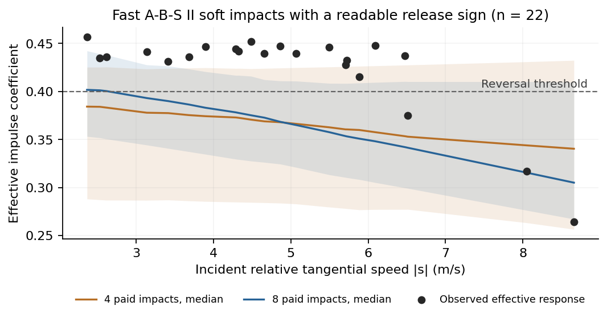

# 빠른 입사에서 이탈 부호가 틀린 경로

V73 Gossard A-B-S II soft의 같은 test와 같은 256개 calibration draw를 고정했다. 빠른 impact는 37개, $|s'|>0.20$ m/s를 만족한 것은 22개다. 5,632는 **22개 impact × 256개 draw**다. 같은 물체를 5,632번 독립 촬영했다고 해석할 수 없다. 이 분석은 동결된 기존 예측에 대한 사후 진단이다. Target test에서 얻은 수치 및 아래 privileged threshold를 보정법의 학습에 사용할 수 없다. [입력 파일 checksum과 분석 결과](results.json)

## 1. 속도 오차 감소가 부호 감소와 다른 이유

$r=Rω_y$, $s=u-r$로 표기한다. $u$는 racket에 대한 접선속도다. Velocity error에는 normal speed 오차도 들어가지만 release sign에는 $u$와 $r$만 들어간다. 빠른 **37개 전체**에서 K=4→8의 velocity error 감소 0.0635 m/s 중, 두 좌표의 교체 순서에 따른 차이를 평균한 기여는 접선 0.0361, normal 0.0274 m/s였다. 약 43%는 normal 성분의 개선이다. 네 가지 벡터 조합을 같은 draw, 같은 test에 적용한 산술 분해다.

판독된 **22개**에서는 K=4→8의 접선속도 MAE가 0.360→0.303, rim speed MAE는 0.604→0.522, $s'$ MAE는 0.944→0.811 m/s로 줄었다. 그런데 부호가 맞다가 틀린 쌍이 734개, 틀리다가 맞은 쌍이 603개여서 accuracy는 37.5→35.2%가 됐다. 연속 오차 감소의 크기와 영점을 넘었는지는 다른 사건이다. K=8의 평균 signed bias는 접선 +0.090, rim −0.271 m/s였다. 두 성분 오류를 $e_u,e_r$라 하면 release MSE는 $E[e_u^2]+E[e_r^2]-2E[e_u e_r]$이다. 각 항은 0.150, 0.410, **+0.440** (m/s)²였다. 두 오차의 곱이 평균적으로 음수이므로 차이를 취할 때 오차가 커진다. 실측 $|s'|>0.50$ m/s의 8개에서도 K=8 적중률은 34.1%여서 주 결과가 0.20 바로 위의 작은 값만으로 생겼다는 설명은 맞지 않는다. [분해와 sensitivity](results.json)

## 2. 어느 성분을 바로잡으면 부호가 회복되는가?

같은 prediction에서 한 성분만 그 impact의 실측값으로 바꿨다. 양쪽을 다 주면 정의상 모든 판독 가능 부호를 맞힌다. 이 실험의 one-component substitution은 모델 오차를 짚는 진단이며, 배포 시 이용할 수 있는 관측이나 독립적인 sensor intervention은 아니다.

| Fast 판독 22개에 대한 적중률 | 4회 calibration | 8회 calibration |
|---|---:|---:|
| 원래 elastic impulse | 37.5% | 35.2% |
| 접선속도만 실측값 대입 | 50.7% | 51.8% |
| Rim speed만 실측값 대입 | 74.5% | **83.3%** |

K=8의 원래 오류 3,651쌍에서 **rim만** 복원하면 고쳐지는 것이 1,856개(50.8%), **접선만** 복원하면 고쳐지는 것이 118개(3.2%)였다. 어느 한쪽을 복원해도 고쳐지는 855개(23.4%), 한 성분만 복원해서는 고쳐지지 않는 822개(22.5%)가 있었다. 원래 맞았던 사례에서 접선만 대입하면 38개의 정답이 깨졌고 rim만 대입했을 때 깨지는 정답은 0개였다. 따라서 rim 오차의 영향이 더 컸고 두 오차의 결합도 무시할 수 없다. 관측된 rim 값 자체의 추정 오차나 실제 rubber의 변형 방향은 이 계산으로 식별되지 않는다. [점별 비교 코드](diagnose.py)

## 3. 모델은 반전 경계를 어디에 두었는가?

V73 elastic impulse의 접선 response는 $\hat u'=u-\alpha s$, $\hat r'=r+\alpha s/\kappa$, $\kappa=2/3$이다. 따라서 $\hat s'=(1-2.5\alpha)s$이고 입사 대비 reversal 경계는 $\alpha=0.4$다. 관측 $s'$에서 $\alpha_{eff}=(1-s'/s)/2.5$를 계산하면 실측 release를 정확히 설명하는 한 좌표를 얻게 된다. 이 값이 측정된 마찰계수라는 뜻은 아니다. 빠른 판독 22개 모두에서 $s\ne0$를 확인했다. 측정값에는 $|Δu+\kappa Δr|$ 평균 0.168 m/s의 제약 잔차가 있어 접선과 회전에서 별도로 추정한 계수도 일치하지 않는다. 하지만 $\alpha_{eff}$ 범위는 22개 모두 모델의 허용 영역 [0,0.8] 안이었다.

관측에서는 **19/22개가 입사 대비 반전**했다. 이는 양·음수 출력의 개수(양수 7개·음수 15개)와 다르다. 모델은 K=4에서 32.5%, K=8에서는 25.2%의 쌍에서만 반전을 예측했다. 관측상 반전한 19개에서 올바른 반전 예측은 32.6→27.0%로 떨어졌고, 반전하지 않은 3개에서는 정답이 68.5→86.7%로 늘었다. $\alpha$의 평균 절대오차는 0.0771→0.0651로 작아지면서도 threshold의 올바른 쪽에 서는 비율은 감소했다.

그림의 음영은 고정된 test impact별로 256개 calibration draw에서 얻은 10–90 percentile이다. 관측된 $\alpha_{eff}$는 이탈값에서 역산한 값이다.

V73에서 $\alpha$는 $|s|$에 대한 clipped affine function이다. 따라서 그 부호 결정은 $|s|$에 최대 한 개의 경계를 둔다. 저장된 모든 draw에서 이 함수를 재구성한 최대 계수 오차는 $9×10^{-16}$ 미만이었다. $|s|$가 작을 때 반전하는 방향으로 기울어진 draw는 K=4의 127/256에서 K=8의 221/256으로 늘었다. 그러나 K=8의 이 221개 draw에서 반전 cutoff의 중앙값은 **2.405 m/s**(90 percentile 4.961)였다. Fast 판독 test의 $|s|$ 중앙값은 4.761 m/s였다. 음의 cutoff가 나오는 경우 관측 가능한 $|s|\ge0$에서 반전을 한 번도 선택하지 않게 된다.

같은 시편에서 **공식 train의 모든** fast 판독 72개를 사용해 방향만으로 threshold를 적합하면 $|s|\le6.592$ m/s에서 반전시키는 규칙이 train 70/72, fast test 21/22개를 맞혔다. 느린 train 281개에만 같은 규칙을 맞추면 cutoff가 약 5.0 m/s로 내려갔고 fast test는 15/22였다. Fast test label을 직접 사용해 그 22개를 가장 잘 가르는 규칙을 **진단용**으로 계산하면 22/22까지 가능했다. 따라서 한 개 threshold를 표현할 수 없기 때문에 실패했다고 볼 수는 없다. 속도별 threshold 위치, 학습 목적, 적은 calibration 정보의 영향이 동시에 가능하다. 공개 train 전체를 사용한 위 규칙은 4회나 8회 방식의 경쟁 성능으로 계수하지 않았다. [Threshold별 정보](results.json) · [22개 impact별 좌표](fast_impacts.csv)

빠른 calibration 부호를 하나도 읽지 못했던 draw가 K=4에서 57/256, K=8에서 9/256이었다. 빠른 예에서 반전과 유지 두 class를 모두 관측한 draw도 각각 24/256과 84/256뿐이었다. 작은 표본에서 어느 threshold를 학습할 수 있는지는 paid evidence로 분리해 검증해야 한다. 이 결과는 특정 시편의 fast test에서 관측된 현상이며 속도 자체가 경계를 바꿨다는 인과 식별이나 미측정 시편으로의 일반화를 제공하지 않는다.
