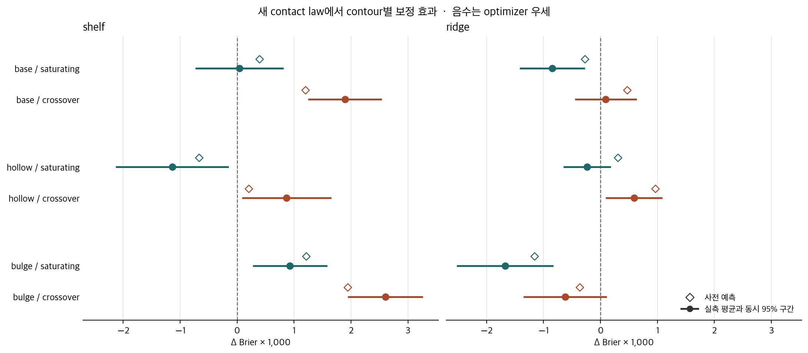

# v40 · 같은 local tangent를 가진 물체에서 언제 보정이 도움이 되는가

**Target label을 보기 전에 v38 optimizer가 고정 32.5% shrinkage를 이길 조건과 질 조건을 모두 예측했고, 두 방향 모두 독립 평가에서 확인했다.** 새 contact law를 적용한 12개 조건에서 평균 차이의 부호가 11개 맞았다. 12개 비교를 함께 보정한 95% 구간은 optimizer 승리 3개와 고정값 승리 5개를 확인했다. 반대 방향이 확인된 조건은 없고, 4개에서는 결론을 유보한다.

가장 명확한 예는 **같은 물체, 같은 local tangent, 같은 saturating law**에서 나왔다. Shelf의 주변 contour가 hollow이면 optimizer가 Brier를 **0.001138 줄였고**, bulge이면 **0.000929 높였다**. 두 부호를 모두 사전에 맞혔다. 동일 물체·동일 noise에서 실제 stick 여부와 선택된 보정량은 내내 같았다. Query view의 주변 형상이 달라져 동일한 보정을 적용한 효과의 크기가 달라졌다.

항상 고정값을 적용한 전체 held-out Brier는 **0.113744**, 항상 optimizer를 적용한 값은 **0.113953**이었다. Δ는 **+0.000208 [−0.000037, +0.000454]**로 전체 평균에서 어느 쪽이 우세한지 확정되지 않았다. 반면 사전에 승리를 예측한 4개 조건에만 optimizer를 쓰면 Brier는 **0.113387**로 양쪽의 고정 정책보다 낮았다. 실제 law·contour 이름을 아는 경우의 정책 선택이다. 1,024개 물체의 GPU p90은 고정값 1,432.1 ms, optimizer 1,434.4 ms로 사전 허용 비용 +2%를 충족했다. 어느 주 비교도 전체 평균의 실용 개선 기준 0.003에 이르지 않았다.



## 실험과 예측은 무엇을 알고 있었는가

한 환경에서 네 번 calibration probe를 실행한 뒤, 아직 그 결과를 보지 않은 다른 물체가 충돌 후 stick할 확률을 예측했다. 같은 128개 물체 중 13개는 deployment probe를, 나머지 115개는 query view를 받았다. 같은 관측으로 얻은 base probability를 p, 첫 세 접촉에서 얻은 signed cue를 z로 두었다. 최종 확률은 sigmoid(logit(p) + 0.828976·z·w)다. Fixed는 항상 w=0.325를 사용한다. V38 optimizer는 네 번째 접촉의 outgoing velocity까지 보고 source gain table에서 w∈[0,1]을 고른다. 두 방식 모두 같은 fixed 4를 사용하므로 이 비교에서 네 번째 접촉의 구매 효과를 추정할 수는 없다. [동결 정책과 timing](POLICY_KO.md)

기본 shelf와 ridge 곡선은 v39에서 가져오고 각 곡선에 새로운 hollow와 bulge를 추가했다. 실제 접촉 높이 0·23·25 mm의 위치와 미분값, 사실 관측에 쓰는 −10~+10 mm의 profile은 같다. 입력은 렌더링한 RGB image 대신 높이별 위치를 재는 geometry sensor다. 7점 query view에서는 주변 contour가 최대 ±0.90 mm, 센서 표준편차 대비 RMS 1.925배 달라진다. 세 contour 모두에 처음 쓰는 두 friction law를 적용했다. Saturating은 속도에 따라 방향 차이가 커지다 포화한다. Crossover는 tangential speed 0.70을 지나면서 마찰의 방향 차이가 부호를 바꾼다. 두 함수는 stress test를 위해 설계했고, 과거부터 쓴 rigid contact와 stick 판정 방식은 공유한다. [물리 명세와 방정식](PHYSICS_KO.md)

조건별 수치 예측에는 v39에서 이미 관측한 정답만 사용했다. 먼저 v39의 query view에 새 contour 변위를 더해 같은 decoder에서 관측 변화의 효과를 추정했다. 다음으로 두 과거 표면 방향에서 관측한 stick label을 새 law의 nominal 속도에서 예측한 마찰 비율로 섞었다. Δ는 두 Brier의 차이이므로 고정한 두 예측에서 label에 대해 선형이다. 이 성질은 과거 label을 섞는 계산을 정당화하지만, 새 law의 실제 label이나 보정량을 알아낼 수 있게 해 주지는 않는다. [사전 예측표와 가정](PREDICTIONS_KO.md)

네 번째 접촉은 23 mm·+1.10, query 충돌은 25 mm·+0.425로 고정했다. 12개 독립 catalog panel 각각에서 두 시작 방향으로 물체를 뽑고, 8개 환경·128개 held-out 물체·32회 sensor noise를 사용했다. 표면 방향 두 가지, query 부근의 방향성이 유지되거나 약해지거나 사라지는 세 regime, 모든 shape × law를 같은 물체와 noise에 대응시켰다. 288개 block archive는 별도로 생성한 288개 독립 catalog를 뜻하지 않는다. 사전 검증 계획과 forecast를 2026-11-15 18:20:44 KST에 서버에서 동결한 뒤 GPU를 실행했다. [설계와 판정 기준](PLAN_KO.md) · [동결 hash](freeze40.sha256)

## 사전 예측과 독립 target 결과

Δ는 **optimizer Brier − fixed Brier**다. 음수이면 optimizer의 확률이 실제 stick 여부에 더 가까웠다. 사전 Δ는 v39 자료의 replay로 계산했다. 새 law나 v40 물체의 정답을 사용하지 않았다. 조건별 구간은 12개 독립 catalog panel, 12개 조건에 대해 보정한 Bonferroni–t 동시 95% 구간이다.

| Tangent / contour / law | 사전 Δ | Fixed Brier | Optimizer Brier | 실측 Δ [동시 95%] | 판정 | Optimizer 우세 panel |
|---|---:|---:|---:|---:|---|---:|
| shelf / base / saturating | +0.000394 | 0.108100 | 0.108141 | +0.000041 [−0.000731, +0.000813] | 미확정 | 6/12 |
| shelf / base / crossover | +0.001200 | 0.118167 | 0.120063 | +0.001896 [+0.001248, +0.002543] | 예측 확인 | 0/12 |
| shelf / hollow / saturating | −0.000667 | 0.112403 | 0.111265 | −0.001138 [−0.002130, −0.000147] | 예측 확인 | 11/12 |
| shelf / hollow / crossover | +0.000207 | 0.120954 | 0.121824 | +0.000870 [+0.000085, +0.001654] | 예측 확인 | 1/12 |
| shelf / bulge / saturating | +0.001214 | 0.108352 | 0.109281 | +0.000929 [+0.000276, +0.001582] | 예측 확인 | 1/12 |
| shelf / bulge / crossover | +0.001939 | 0.119088 | 0.121691 | +0.002603 [+0.001942, +0.003263] | 예측 확인 | 0/12 |
| ridge / base / saturating | −0.000271 | 0.107173 | 0.106325 | −0.000848 [−0.001421, −0.000276] | 예측 확인 | 12/12 |
| ridge / base / crossover | +0.000468 | 0.116559 | 0.116652 | +0.000093 [−0.000449, +0.000635] | 미확정 | 6/12 |
| ridge / hollow / saturating | +0.000302 | 0.106589 | 0.106353 | −0.000236 [−0.000651, +0.000179] | 미확정 | 10/12 |
| ridge / hollow / crossover | +0.000963 | 0.117108 | 0.117697 | +0.000589 [+0.000089, +0.001089] | 예측 확인 | 0/12 |
| ridge / bulge / saturating | −0.001160 | 0.111419 | 0.109743 | −0.001676 [−0.002526, −0.000825] | 예측 확인 | 12/12 |
| ridge / bulge / crossover | −0.000362 | 0.119019 | 0.118398 | −0.000621 [−0.001352, +0.000110] | 미확정 | 9/12 |

음수·양수 어느 쪽도 동시 구간으로 확인할 수 없으면 미확정으로 기록했다. 각 panel 안에서 두 시작 방향과 모든 paired 환경을 먼저 평균했다. 개별 물체의 승패 적중률과 다른 단위다. [사전 예측](PREDICTIONS_KO.md) · [Panel별 Brier](stats40.json)

### 부호를 맞히는 것과 이득 크기를 맞히는 것

| Forecast에 쓰는 정보 | 12개 cell의 MAE | 부호 적중 | Spearman ρ | Full − 해당 forecast의 MAE 차이 [paired bootstrap 95%] |
|---|---:|---:|---:|---:|
| v39 전체 평균 | 0.001051 | 5/12 | 정의되지 않음 | −0.000570 [−0.000761, −0.000384] |
| Tangent family만 사용 | 0.000960 | 5/12 | 0.531 | −0.000479 [−0.000712, −0.000306] |
| Tangent와 law를 사용하고 contour 변화를 무시 | 0.000704 | 10/12 | 0.756 | −0.000223 [−0.000340, −0.000136] |
| Tangent, law, 관측 contour를 모두 replay | 0.000481 | 11/12 | 0.916 | 기준 |

사전에 Δ<0인 조건에서만 optimizer를 고르면 Brier는 0.113387이다. 항상 fixed와의 차이는 −0.000357 [−0.000490, −0.000224], 항상 optimizer와의 차이는 −0.000565 [−0.000717, −0.000414]였다. 두 구간은 각각 pointwise 95%다. 이 선택은 설계자가 아는 shape·law를 사용하므로 미지 표면의 online router 성능과 구분해야 한다. [Forecast 채점](forecast_eval40.json)

## 같은 tangent와 물체에서 off-contact contour만 바꾼 효과

표에서 Δ 변화는 (변형 contour의 optimizer−fixed) − (base의 optimizer−fixed)다. 음수일수록 해당 변형이 optimizer에 상대적으로 유리하다. 아래의 절대 Brier 변화는 각 정책 안에서 base와 비교한 값이다.

| 조건 | Δ 변화 [8개 동시 95%] | Fixed Brier 변화 | Optimizer Brier 변화 | Query를 받은 물체의 평균 절대 base probability 변화 |
|---|---:|---:|---:|---:|
| shelf / hollow / saturating | −0.001180 [−0.001520, −0.000839] | +0.004303 | +0.003124 | 0.03334 |
| shelf / bulge / saturating | +0.000888 [+0.000584, +0.001191] | +0.000252 | +0.001140 | 0.03410 |
| shelf / hollow / crossover | −0.001026 [−0.001373, −0.000679] | +0.002787 | +0.001761 | 0.03316 |
| shelf / bulge / crossover | +0.000707 [+0.000402, +0.001012] | +0.000921 | +0.001628 | 0.03403 |
| ridge / hollow / saturating | +0.000613 [+0.000385, +0.000840] | −0.000584 | +0.000028 | 0.03772 |
| ridge / bulge / saturating | −0.000827 [−0.001125, −0.000530] | +0.004246 | +0.003419 | 0.03420 |
| ridge / hollow / crossover | +0.000496 [+0.000270, +0.000721] | +0.000549 | +0.001045 | 0.03764 |
| ridge / bulge / crossover | −0.000714 [−0.001022, −0.000406] | +0.002460 | +0.001746 | 0.03401 |

형상을 바꾼 모든 짝에서 stick label·sensor 선택·signed cue·보정량이 같았다. Probe branch에서 base probability도 같았다. 두 경로를 교환해 loss를 다시 계산하면 contour 효과 전부가 query view를 통한 base probability 변화로 복원된다. 이 결과는 접촉 위치를 고정한 본 simulator의 설계와 실측을 함께 반영한다. [분해와 negative control](stats40.py) · [검산 수치](stats40.json)

## GPU p90

| 방법 | 1,024개 물체의 GPU p90 | Matched-panel bootstrap 95% 구간 |
|---|---:|---:|
| Fixed 32.5% | 1,432.1 ms | [1,427.0, 1,437.2] ms |
| Frozen v38 optimizer | 1,434.4 ms | [1,427.5, 1,437.9] ms |

비율은 1.00157 [0.99911, 1.00384]로, 상한 ≤1.02인 사전 조건을 충족했다. 서버 GPU 한 장에서 24개 timing cluster, 각 방법당 72회 측정했다. 한 번의 warm online 호출에 acquisition, 선택한 센서의 decoder, 보정 선택과 host 반환이 들어간다. 실제 probe·로봇 reset·bank 구축은 제외했다. [GPU 실행](run40.py) · [Timing 원자료와 산출 방식](stats40.json)

## 형상에 따라 승패가 달라진다는 말의 단위

개별 시행에서 fixed와 optimizer의 stick 확률을 각각 qꜰ, qᴏ라 하면 두 Brier의 차이는 **(qᴏ−qꜰ)(qᴏ+qꜰ−2Y)**다. 0과 1 사이의 확률에서 Y=1이면 더 높은 확률을 낸 쪽이 이기고, Y=0이면 더 낮은 확률을 낸 쪽이 이긴다. 두 정책이 같은 base p에 logit 보정을 가하므로 qᴏ−qꜰ의 방향은 **z(w−0.325)**가 결정한다. V40의 contour 대조에서는 같은 물체의 Y·z·w가 모두 고정된다.

따라서 contour가 **한 시행에서 어느 정책이 더 가까운지**를 뒤집을 수는 없다. 바뀔 수 있는 값은 그 시행에서 이기거나 지는 **폭**이다. 예를 들어 두 정책이 stick 확률을 모두 1에 가깝게 예측하는 물체는 보정 차이가 작아 평균에 작게 기여할 수 있다. 주변 contour가 달라져 decoder가 중간 확률을 내면 같은 보정이 더 크게 작용한다. 이미 optimizer가 이기던 물체와 지던 물체에서 이 변화가 비대칭이면 **같은 tangent family 전체의 평균 승자**가 바뀐다. Law까지 바꾸는 대조에서는 Y·z·w도 바뀔 수 있어서 이 개별 시행 불변성이 적용되지 않는다. [실측 부호와 손실 기여 검산](sign_audit40.json)

## Law와 관측 방향에 대한 보조 대조

**Law 이름이 없는 경우.** 같은 contour에서 두 law의 사전 예측을 평균했다. 부호는 9/12에서 맞고 MAE는 0.000705였다. Law를 아는 full forecast의 MAE는 0.000481이며, law를 가렸을 때의 MAE 변화의 95% 구간은 [+0.000200, +0.000339]였다. 이 규칙이 고른 정책의 Brier는 0.113530, full forecast가 고른 정책 대비 차이는 +0.000143 [+0.000095, +0.000192]였다. 이 결과도 contour 이름과 후보 law 두 개의 비율을 안다고 가정한다. 주 실험 시작 뒤 target score 열람 전에 추가한 대조다. [보조 계획](LAW_BLIND_PLAN_KO.md) · [수치](law_blind40.json)

**Decoder가 contour 변화에 둔감해지면 어떻게 되는가.** Query view의 7개 좌표 중 변형이 일어나는 한 방향을 미리 알고 있다고 가정했다. 관측과 256개 template을 sensor noise로 표준화한 뒤 그 방향에 수직인 여섯 차원만으로 posterior를 계산했다. 실제 변형의 부호·진폭, law, label은 사용하지 않았다. 각 catalog에서 홀짝으로 정한 한 block만 사용해 두 decoder에 동일하게 적용했다.

| 동일한 절반 표본 | Original Brier | Projected Brier | Projected − original [pointwise 95%] |
|---|---:|---:|---:|
| Fixed 32.5% | 0.113797 | 0.111912 | −0.001885 [−0.002047, −0.001724] |
| Optimizer | 0.114191 | 0.112399 | −0.001792 [−0.001947, −0.001638] |

| Contour | Projection이 바꾼 fixed Brier | Projection이 바꾼 optimizer Brier |
|---|---:|---:|
| base | −0.000589 | −0.000593 |
| hollow | −0.002611 | −0.002287 |
| bulge | −0.002456 | −0.002498 |

같은 물체의 변위가 제거한 방향과 평행하므로 projected probability는 이론적으로 세 contour에서 같다. 실제로 각 batch에서 점검한 paired query의 최대 오차는 2.4e-14였다. Projected decoder에서 optimizer − fixed는 +0.000487 [+0.000060, +0.000915]다. 변형 방향을 아는 이 대조는 nuisance 제거로 얻는 이득과 유효한 기하 정보를 같이 잃는 비용을 포함한다. 이 보조 decoder만의 GPU p90은 측정하지 않았다. [사전 계획](PROJECTION_PLAN_KO.md) · [48개 paired world group 결과](projection40.json) · [구현](projection40.py)

## 예측이 맞은 조건, 실패한 조건, 논문에 남길 주장

**양방향 예측은 성공했고, 오차가 집중된 조건도 식별할 수 있었다.** 가장 큰 optimizer 이득으로 예측한 ridge/bulge/saturating에서 Δ는 −0.001676, 고정값의 가장 큰 이득으로 예측한 shelf/bulge/crossover에서는 +0.002603이었다. 각 조건에서 12개 panel의 부호가 모두 해당 방향이었다. 유일하게 실측 부호를 틀린 ridge/hollow/saturating에서는 +0.000302를 예상했으나 −0.000236 [−0.000651, +0.000179]이었다. 이 조건의 query view branch만 보면 예상한 부호(+0.000208)였고, 13/128을 차지하는 probe branch의 Δ가 −0.004158이어서 합한 평균은 뒤집혔다. 센서는 동일한 상황에 무작위 배정한 것이 아니므로 두 branch 간 차이를 센서 교체의 causal effect로 볼 수 없다. [Sensor별 결과와 원자료 검산](RAW_AUDIT_KO.md)

**형상과 law가 각각 제공한 정보.** 과거 law에서 contour만 바꿔 replay한 예측은 base 대비 8개 contour 대조의 방향을 모두 맞혔고, 8개 실측 대조 모두에 대한 동시 구간이 0을 벗어났다. Law를 바꾼 6개 대조에서도 실측 변화의 방향을 모두 맞혔다. 조건별 Δ 자체의 MAE는 0.000481로, 과거 전체 평균(0.001051), tangent만 사용(0.000960), contour를 생략한 replay(0.000704)보다 작았다. 다만 사전 수치가 실제 개선·악화의 크기까지 그대로 전달되지는 않았다. 이 적중률은 미리 고른 두 family와 두 law를 대상으로 한 결과다. [예측 검산](forecast_validation40.json) · [Source replay 표본을 바꾼 민감도](source_contour_check40.json)

**같은 승자가 더 많이 이기거나 덜 지면서 평균 순위가 뒤집혔다.** Shelf/saturating의 hollow→bulge에서 평균 Δ가 +0.002067 변했다. 그중 약 88%는 optimizer가 이기던 시행에서 이득이 작아진 몫이다. 같은 latent draw와 두 contour를 대응한 37,748,736개 쌍에서 양쪽 손실 차이가 모두 10⁻¹²를 넘는 개별 승자 반전은 0건이었다. 10⁻¹² 이하를 포함한 원래 부호 비교에서는 105,474건의 반대 부호가 있어 반올림과 거의 동점인 예측을 분리했다. [개별 손익 분해](SIGN_AUDIT_KO.md)

**Law를 바꾸면 정답 자체도 바뀌었다.** Saturating에서 crossover로 바꾸자 Δ가 평균 +0.001393 [+0.001166, +0.001620] 이동했다. 같은 표본에 두 law의 출력을 교차 대입해 base probability, 보정 단서 (z,w), label을 바꾸는 여섯 순서를 평균하면 세 항은 각각 −0.000034, +0.000075, +0.001352였다. 마지막 값이 가장 컸다. 실제 stick label이 달라진 대응 비율은 shelf 5.35%, ridge 4.00%였다. 이전 방향의 label을 무조건 반대로 대응시키는 계산만으로는 law 간 변화의 크기를 재현하지 못했다. 이 분해는 수학적으로 구성한 조합의 기여이며 각 항을 따로 물리적으로 개입한 실험과 구분해야 한다. [Law 간 분해](LAW_DIAGNOSTICS_KO.md) · [속도와 접촉 상태 검산](PHYSICS_AUDIT_KO.md)

**Projection은 더 단순한 경쟁 가설을 남긴다.** 알려진 contour 변형 방향 하나를 query decoder에서 제외하자, 같은 절반 표본에서 fixed의 Brier가 0.113797에서 0.111912로 낮아졌다. 평균 감소 0.001885는 주 실험에서 보정 정책을 골라 얻은 개선보다 수치상 크지만 표본과 사용한 사전 정보가 다르다. 기본 contour에서도 fixed Brier가 0.000589 감소했다. 보정량을 잘 선택하는 것 외에, 어느 관측 좌표를 decoder가 물리 정보로 받아들여야 하는지도 직접적인 연구 질문이 된다. 이 실험의 projector는 변형 방향을 정확히 알고 있다. 미지 영상에서 학습한 projector가 같은 이득을 낸다는 근거는 아직 없다. [Decoder 대조 원자료](projection40.json)

**논문 기여 판단.** 제한된 synthetic benchmark에서의 전향적 예측·기전 분석으로는 본문에 쓸 근거가 생겼다. v39에서 이루지 못한 '같은 tangent에서 optimizer가 질 조건까지 예고한다'는 판정을 이번에는 통과했다. 특히 label을 보지 않고 예측한 같은 family 내 평균 순위 반전, 개별 시행의 부호 불변성, decoder 방향 하나를 제거한 대조를 함께 제시하면 현상의 범위가 명확하다. 반면 11/12를 임의의 새 물체에서 92% 정확도로 판정한다는 결과로 확대할 수 없다. 물리적 형상은 두 과거 기본 곡선에 같은 한 방향의 양·음 변위를 얹은 계열이고, law 식은 실험자가 알고 있으며, 접촉 위치는 고정이고 입력은 7점 profile이다. 독립 실물 표면, RGB 영상, 알 수 없는 contact point에 대한 근거는 없다. 평균 실용 효과와 실제 행동 이득 역시 미확인이다.

다음 검증으로는 **학습에 쓰지 않은 contour 변형 방향과 접촉 높이를 가진 새 물체에서, label 없이 추정한 관측 방향이 여전히 유용한지**를 우선한다. 별도 shape family에서 학습한 geometry representation, 원래 K256 decoder, 위의 정확한 방향을 아는 projector를 같은 factual budget으로 비교한다. 물체 전체와 contact law 전체를 제외해 평가하고, law 이름도 숨긴 정책의 Brier·실제 관측 비용·승리와 패배의 사전 예측을 함께 판정한다. 여기서 단순 decoder 수정보다 보정 정책 선택의 추가 이득이 남는지가 방법론 논문으로 발전할 판단 기준이다.

## 선행연구에서 무엇을 가져왔는가

아래 비교는 접촉 역학, 관측 불변성, 판단의 외부 검증을 다룬 원문을 대상으로 한다. v40의 성능 수치는 자체 실험에서 산출했다. 문헌에서 다른 hardware나 평가 지표로 측정한 값을 v40의 성능 근거로 사용하지 않았다.

| 원문과 연구 질문 | 방법·표본 | 결과와 결론 | v40에 적용할 때의 한계 |
|---|---|---|---|
| Yu et al. 실제 마찰은 재료·위치·속도·방향에 따라 얼마나 변하는가? | 로봇의 planar pushing에서 재료, 형상, 접촉 위치, 방향, 속도, 가속도를 바꿨다. 네 재료의 마찰을 따로 측정했다. | 세 재료의 속도 변화는 작았고 polyurethane은 고속에서 큰 변화와 방향 차이를 보였다. | 실제 마찰 이질성의 근거다. 새 속도에서 방향성이 반전되는 v40의 crossover 식을 실측한 자료는 아니다. [원문](https://arxiv.org/pdf/1604.04038) |
| Datta et al. 물체를 미는 방향과 속도에 따라 friction response가 함께 달라지는가? | 약 57° 기울어진 titania nanorod에서 force microscopy로 네 속도와 두 배치의 마찰을 측정했다. | 속도가 커질 때 마찰이 감소하는 정도가 측정 축에 따라 달랐다. | 특정 microscale sliding 재료의 실측이다. v40 crossover의 기준 속도나 충돌에서의 방향 반전은 별도 가정이다. [원문](https://arxiv.org/abs/2602.13343) |
| Fazeli et al. 실제 충돌에서 모델 parameter를 식별할 수 있는가? | 로봇이 떨어뜨린 planar object의 2,000회 drop 중 품질 검사를 통과한 1,718회에 6개 rigid-body model을 비교했다. | Impulse의 표현 범위와 parameter 식별에 제약이 있었고, sticking impact에서는 friction에 하한만 주어졌다. | 같은 calibration cue가 다른 query로 전달되는 가설을 시험할 근거가 된다. 실물 결과는 이번 analytic law의 수치를 뒷받침하지 않는다. [원문](https://arxiv.org/pdf/1710.04979) |
| Zhong et al., ActivePusher. 적은 실행으로 pushing dynamics와 planning을 개선할 수 있는가? | Residual physics와 uncertainty로 실험과 계획을 선택했다. Simulation 4종, 실물 UR10 2종의 물체에서 skill learning을 평가하고 물체당 독립 test sample 1,000개를 사용했다. | 적극적으로 고른 학습 관측과 residual model로 data efficiency 및 planning success가 개선됐다. | 접촉 후 다른 물체의 stick 확률을 네 번의 측정으로 맞히는 비교와는 표본·목표가 다르다. [원문](https://arxiv.org/pdf/2506.04646) |
| Simard et al., Tangent Prop. 알려진 입력 변형에 둔감하게 만들면 일반화가 좋아지는가? | 문자 영상의 작은 이동·회전 등 알려진 변환을 tangent vector로 표현해 학습에 반영했다. | 입력을 어느 방향으로 바꿀 때 출력이 유지되어야 하는지를 지정할 수 있음을 보였다. | 여기서 tangent vector는 **영상 변환 방향**이다. v40의 물리적 local tangent와 다르다. Known nuisance direction을 제거한다는 아이디어 자체의 독창성은 낮다. [원문](https://proceedings.neurips.cc/paper/1991/file/65658fde58ab3c2b6e5132a39fae7cb9-Paper.pdf) |
| Koh et al., WILDS. 기존 성능이 자연적인 distribution shift에서도 유지되는가? | 병원·지역·시기 등을 달리한 10개 dataset에서 평가했다. | 표준 학습은 분포 밖에서 성능이 떨어졌고 여러 대응 방법에도 차이가 남았다. | 자연 집단의 넓은 대표성이 강점이다. 같은 물체에서 nuisance만 바꾸는 효과는 v40의 paired simulator가 더 직접적으로 측정한다. [원문](https://proceedings.mlr.press/v139/koh21a.html) |
| Yao et al. 각 조건에서 다른 predictive model이 유리할 때 어떻게 결합하는가? | Bayesian hierarchical stacking에서 input-dependent weight를 partial pooling하고 이론 및 여러 응용 자료로 검증했다. | 예측 성능의 이질성을 반영하는 weight를 추정할 수 있다. | 새 물리 law에서 어느 보정량이 이길지 선험적으로 알 수 있다는 정리는 아니다. v40은 동결한 weight의 transfer를 직접 채점한다. [원문](https://arxiv.org/abs/2101.08954) |
| Brier. 확률로 표현된 예보를 어떻게 검증하는가? | 기상 예보의 평가 문제에서 각 사건의 예측 확률과 실제 발생을 제곱 오차로 비교했다. 방법론 논문으로 독립 물체 표본 수는 적용되지 않는다. | 관측과 예측의 거리를 정량화하는 scoring rule을 제시했다. | 본 보고서는 이진 사건의 양성 class 한 항 (p−y)²를 사용한다. 예측 개선을 작업 성공률로 변환하려면 별도 행동과 비용을 정해야 한다. [원문](https://journals.ametsoc.org/view/journals/mwre/78/1/1520-0493_1950_078_0001_vofeit_2_0_co_2.xml) |
| Rossa et al., Action-BED. Task loss를 줄이는 관측을 학습할 수 있는가? | Joint model에서 expected future loss를 사용했다. Source location 예제는 30단계 정책을 2,048개 rollout으로 평가했다. | 측정 목적을 downstream loss에 맞춘 sequential design을 구성하고 검증했다. | v40에서 두 방법은 같은 probe를 구입한다. 결과를 probe 자체의 가치나 최적 실험 횟수로 해석할 수 없다. [원문](https://arxiv.org/html/2606.23662v2) |

**증거의 연결.** 실물 자료에는 접촉 조건에 따라 마찰이 바뀌고 stick 상태에서 동역학을 유일하게 알아내기 어려운 사례가 있다. 이 두 관찰은 단일 contact model의 transfer를 검증할 이유를 제공한다. 입력 변형에 대한 불변성과 조건별 weight 결합은 존재하는 방법이다. v40의 open question은 주변 contour가 유효한 stick 정보를 얼마나 제공하는지, 또 source에서 추정한 보정의 순위를 law가 달라져도 target label 없이 예고할 수 있는지다. [Yu et al.](https://arxiv.org/pdf/1604.04038) · [Fazeli et al.](https://arxiv.org/pdf/1710.04979) · [Simard et al.](https://proceedings.neurips.cc/paper/1991/file/65658fde58ab3c2b6e5132a39fae7cb9-Paper.pdf) · [Yao et al.](https://arxiv.org/abs/2101.08954)

**결과가 달라 보이는 이유.** 같은 실물 연구에서도 재료별 speed dependence가 다르다. ActivePusher가 보고한 planning 개선과 rigid impact 연구가 보고한 friction 식별 한계도 논리적으로 양립한다. 전자는 residual dynamics와 action sequence의 성공을, 후자는 충돌 하나가 parameter를 얼마나 제약하는지를 측정했다. 실물에 대한 근거는 이 범위에 있고, v40의 analytic law·고정 높이·한 방향의 시각 변형을 넘어서는 증거는 부족하다. [실제 재료별 측정](https://arxiv.org/pdf/1604.04038) · [로봇 planning](https://arxiv.org/pdf/2506.04646) · [Impact 식별](https://arxiv.org/pdf/1710.04979)

| 다음 연구 질문 | 근거와 중요성 | 변수와 검증 |
|---|---|---|
| 1. 실제 재료에 같은 속도 반전이 존재하는가? | [Yu et al.](https://arxiv.org/pdf/1604.04038)의 재료별 속도·방향 차이는 반전 여부까지 결정하지 않는다. | 양방향 속도 sweep으로 material별 마찰 곡선을 동결한 후 holdout 충돌을 검증한다. |
| 2. 접촉점의 높이가 움직여도 형상 효과가 남는가? | [Fazeli et al.](https://arxiv.org/pdf/1710.04979)에서 국소 운동 상태가 예측 정확도에 영향을 준다. | Height jitter의 크기를 정해 local normal과 label이 바뀌는 비율을 함께 측정한다. |
| 3. 카메라에서 nuisance 방향을 알아낼 수 있는가? | [Tangent Prop](https://proceedings.neurips.cc/paper/1991/file/65658fde58ab3c2b6e5132a39fae7cb9-Paper.pdf)은 알려진 변형을 출발점으로 삼는다. | 정답 없는 paired image로 방향을 추정하고 synthetic oracle projection과 Brier를 비교한다. |
| 4. 여러 nuisance 방향을 제거하면 어디서 정보 손실이 생기는가? | 같은 [변환 불변성 연구](https://proceedings.neurips.cc/paper/1991/file/65658fde58ab3c2b6e5132a39fae7cb9-Paper.pdf)에서 불변으로 지정할 방향은 사전 지식이다. | Rank 1~3의 projection과 무변형 control에서 손익을 측정한다. |
| 5. 특정 probe 속도만으로 새 law를 구별할 수 있는가? | [Fazeli et al.](https://arxiv.org/pdf/1710.04979)의 stick 식별 한계로 같은 관측이 여러 해를 허용한다. | 속도 crossing의 양옆에서 1회씩 probe해 held-out law discrimination과 Brier를 잰다. |
| 6. 추가 접촉의 Brier 감소가 접촉 비용을 상쇄하는가? | [Action-BED](https://arxiv.org/html/2606.23662v2)는 downstream loss를 실험 목적으로 삼는다. | Fixed 3/4 정책에서 측정·reset 시간과 slip 비용을 같은 utility로 정의한다. |
| 7. 조건 비중이 달라도 최선의 보정이 유지되는가? | [WILDS](https://proceedings.mlr.press/v139/koh21a.html)에서 분포 구성의 변화가 성능에 영향을 준다. | 별도 material cohort에서 prevalence를 얻어 동일 정책을 재평가한다. |
| 8. 항상 source 평균 Δ만 쓰는 예측보다 나은가? | [Hierarchical stacking](https://arxiv.org/abs/2101.08954)은 이질성 활용에 자료가 필요함을 보인다. | 완전히 제외한 다수의 law에서 pooled·law-only·full forecast의 MAE를 비교한다. |
| 9. 확률 정확도 차이가 실제 manipulation 성공률로 이어지는가? | [ActivePusher](https://arxiv.org/pdf/2506.04646)는 planning까지 평가한다. | 미리 정한 행동 threshold에서 slip·오선택 비용·cycle time을 함께 기록한다. |
| 10. 하나의 접촉 simulator에서 찾은 손해 조건이 다른 solver에서도 재현되는가? | [Fazeli et al.](https://arxiv.org/pdf/1710.04979)에서 6개 contact model은 impulse를 다르게 설명한다. | 다른 solver를 블라인드 target으로 두고 동일한 forecast와 matched geometry를 재검증한다. |

## v40 실행 기록과 원자료

서버 작업 경로는 `datacenter3:/scratch2/mdj1412/temporarily_dir/vlm-playground/physics-scene-belief/tangent_transfer_v40`다. 2026-11-15 09:20:44 UTC(18:20:44 KST), `results` 경로가 존재하지 않음을 확인한 뒤 사전 계획, 예측표, 데이터 생성, 실행·분석에 쓰는 14개 파일의 SHA-256을 기록했다. Manifest 자체의 digest는 `1bad064943fc0beaf59dfe1bb8a8222e57a59818535a7609f50f6014c8f7d059`이다. V38 optimizer 파일의 digest는 `9ba308386d5e3275cf22160d34a2d6b030f8fbc5e746a76aa87bfa6742e857e8`이다. V38 정책과 source 자료의 기존 manifest도 새 worker에서 검증한다. [동결 기록](freeze40.sha256) · [서버 시각](frozen_utc.txt) · [GPU 환경](results/run.json)

Slurm allocation 2744468의 node55에서 compute PID가 없고 memory 0 MiB 및 utilization 0%인 NVIDIA RTX PRO 6000 Blackwell Server Edition 한 장을 사용했다. 두 정책은 동일 hardware에서 순서를 섞어 측정했다. 서버 프로젝트 안에서 새로운 작업 사본에 재실행하는 명령은 다음과 같다. 기존 사본에서 중간에 끊긴 실행을 재개할 때는 manifest와 SHA-256이 모두 일치하는 block만 재사용한다.

```bash
sha256sum -c freeze40.sha256
srun --overlap --jobid="$GPU_ALLOCATION" -n1 bash run40.sh
```

`results/<family>_<contour>_<law>/catalog_<id>/block_<id>.npz`마다 2개 orientation × 3개 regime × 두 정책 × 8개 환경의 loss, calibration 관측·보정량, held-out label, 선택된 sensor의 base probability와 timing을 저장한다. 같은 경로의 JSON에는 물체 추출 seed·QMC bank seed·SHA-256이 있다. 한 쌍의 물체 비교에서 target label, sensor 선택과 acquisition의 입력을 함께 검산할 수 있다. [GPU 실행 코드](run40.py) · [Brier 독립 재계산](audit40.py) · [생성물 목록과 완료 기록](results/completion.json)

독립 CPU 검산과 논문 표의 재계산은 같은 서버 환경의 compute node에서 실행한다.

```bash
export CUDA_VISIBLE_DEVICES='' BELIEF_DEVICE=cpu OPENBLAS_NUM_THREADS=1 OMP_NUM_THREADS=1
py=../continuous_v2/.venv/bin/python
"$py" audit40.py
"$py" stats40.py
```
