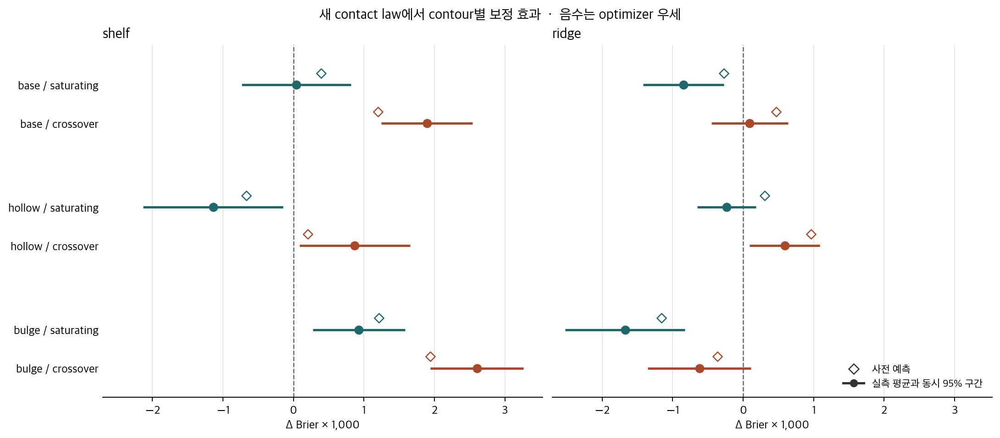

# v40 · 같은 local tangent를 가진 물체에서 언제 보정이 도움이 되는가

**Target label을 보기 전에 v38 optimizer가 고정 32.5% shrinkage를 이길 조건과 질 조건을 모두 예측했고, 두 방향 모두 독립 평가에서 확인했다.** 새 contact law를 적용한 12개 조건에서 평균 차이의 부호가 11개 맞았다. 12개 비교를 함께 보정한 95% 구간은 optimizer 승리 3개와 고정값 승리 5개를 확인했다. 반대 방향이 확인된 조건은 없고, 4개에서는 결론을 유보한다.

가장 명확한 예는 **같은 물체, 같은 local tangent, 같은 saturating law**에서 나왔다. Shelf의 주변 contour가 hollow이면 optimizer가 Brier를 **0.001138 줄였고**, bulge이면 **0.000929 높였다**. 두 부호를 모두 사전에 맞혔다. 동일 물체·동일 noise에서 실제 stick 여부와 선택된 보정량은 내내 같았다. Query view의 주변 형상이 달라져 동일한 보정을 적용한 효과의 크기가 달라졌다.

항상 고정값을 적용한 전체 held-out Brier는 **0.113744**, 항상 optimizer를 적용한 값은 **0.113953**이었다. Δ는 **+0.000208 [−0.000037, +0.000454]**로 전체 평균에서 어느 쪽이 우세한지 확정되지 않았다. 반면 사전에 승리를 예측한 4개 조건에만 optimizer를 쓰면 Brier는 **0.113387**로 양쪽의 고정 정책보다 낮았다. 실제 law·contour 이름을 아는 경우의 정책 선택이다. 1,024개 물체의 GPU p90은 고정값 1,432.1 ms, optimizer 1,434.4 ms로 사전 허용 비용 +2%를 충족했다. 어느 주 비교도 전체 평균의 실용 개선 기준 0.003에 이르지 않았다.

